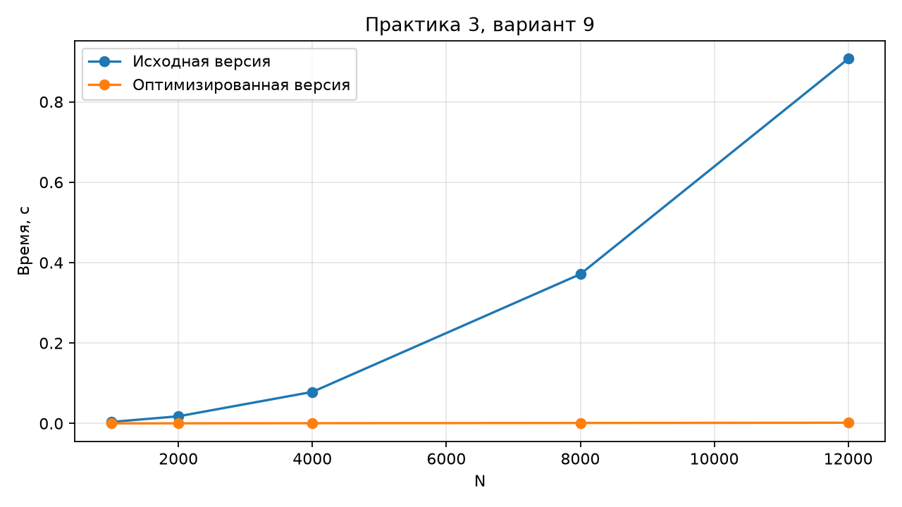

# Практическое занятие № 3. Вариант 9

**Выполнил: Ефремов А. ЭФБО-10-23**

**Дисциплина:** Оптимизация программного кода

**Тема:** Профилирование и оптимизация производительности кода.

## Задача и исходный подход

Программа выбирает события заданного типа, сортирует их по времени, подсчитывает число событий и пользователей, затем возвращает пять пользователей с наибольшей суммой значений. Исходная версия использует пузырьковую сортировку, список уникальных пользователей, повторный обход событий для каждого пользователя и полную сортировку выбором.

Обозначения: N — все события, M — выбранные события, U — их пользователи. Фильтрация: O(N); пузырьковая сортировка: O(M²); поиск уникальных пользователей и группировка: O(M·U); сортировка пользователей: O(U²). Итого O(N + M² + M·U + U²), в худшем случае O(N²); дополнительная память O(M + U).

## Условия измерений

Python 3.14.8, Linux-7.2.11-1-cachyos-x86_64-with-glibc2.44. random.seed(42); пять повторений, в таблицах медиана времени perf_counter без профилирования. Перед каждым повторением вызывается gc.collect(). Измерения версий выполнялись последовательно. Для каждой точки обе версии получают один и тот же список событий; генерация исключена из времени. Выбраны N = 1000, 2000, 4000, 8000, 12000: этого достаточно для наблюдения квадратичного роста без чрезмерного времени исходной сортировки.

## Базовые замеры

| N | Время до, с |
| --- | --- |
| 1000 | 0.003707 |
| 2000 | 0.017729 |
| 4000 | 0.078415 |
| 8000 | 0.371257 |
| 12000 | 0.907019 |

## Профилирование и узкие места

cProfile на N = 12000 показывает, что основное время сосредоточено в process_events; внутри неё встроенных вызовов мало, поэтому операции циклов уточнены через line_profiler.

```text
10958 function calls in 0.947 seconds

   Ordered by: cumulative time

   ncalls  tottime  percall  cumtime  percall filename:lineno(function)
        1    0.932    0.932    0.947    0.947 variant_9_baseline.py:15(process_events)
     9154    0.012    0.000    0.012    0.000 {method 'append' of 'list' objects}
     1801    0.002    0.000    0.002    0.000 {built-in method builtins.len}
        1    0.000    0.000    0.000    0.000 {method 'disable' of '_lsprof.Profiler' objects}
        1    0.000    0.000    0.000    0.000 {method 'items' of 'dict' objects}
```

| Строка исходника | Операция | Доля времени line_profiler |
| --- | --- | --- |
| 23 | Сравнение timestamp | 32,5 % |
| 22 | Внутренний цикл сортировки | 30,4 % |
| 24 | Обмен событий | 15,9 % |
| 32 | Повторный обход событий | 9,8 % |
| 33 | Проверка пользователя | 9,8 % |
| 49 | Сравнение сумм пользователей | 0,7 % |

Доли относятся к отдельному запуску с построчным профилированием; профилировщик увеличивает время, поэтому эти секунды не используются для расчёта ускорения. Три строки пузырьковой сортировки занимают около 78,8 % времени; повторные проходы по пользователям — ещё около 19,6 %.

## План оптимизации и реализация

| Проблема | Изменение | Ожидаемый эффект |
| --- | --- | --- |
| Пузырьковая сортировка | sorted по timestamp | O(M²) → O(M log M) |
| Поиск в списке user_ids | Словарь сумм по user_id | Ожидаемое O(1) на обращение |
| Обход M событий для каждого из U пользователей | Накопление сумм за один проход | O(M·U) → O(M) |
| Неиспользуемые count и avg | Хранить только сумму | Меньше объектов и вычислений |
| Полная сортировка top | Первые min(5, U) шагов отбора | O(U²) → O(5U) |

Сортировка событий остаётся стабильной, поэтому порядок сложения float сохранён точно. Первые пять шагов исходной сортировки выбором сохраняют её поведение при равных суммах; обычная стабильная сортировка пользователей могла бы дать иной порядок. Итоговая ожидаемая сложность O(N + M log M + U), дополнительная память O(M + U).

## Проверка корректности

pytest: 13 тестов прошли. Известные ответы проверены на обеих версиях; выполнено сравнение на пяти размерах, проверено отсутствие изменения входного списка. Отдельные тесты проверяют равные суммы и порядок сложения float.

```text
13 passed
```

## Повторные замеры

| N | До, с | После, с | Ускорение |
| --- | --- | --- | --- |
| 1000 | 0.003707 | 0.000141 | 26.22× |
| 2000 | 0.017729 | 0.000281 | 63.15× |
| 4000 | 0.078415 | 0.000547 | 143.43× |
| 8000 | 0.371257 | 0.001099 | 337.96× |
| 12000 | 0.907019 | 0.001679 | 540.27× |



## Вывод

При увеличении N с 1000 до 12000 исходное время выросло в 244.7 раза, что согласуется с квадратичной составляющей. На N = 12000 время сократилось с 0.907019 до 0.001679 с, ускорение — 540.3 раза. Алгоритм стал сложнее только в выборе top5, где требуется сохранить исходный порядок равных элементов. Память остаётся линейной. Дальнейшая оптимизация возможна, если вход уже отсортирован по времени; текущая функция такого условия не требует.
