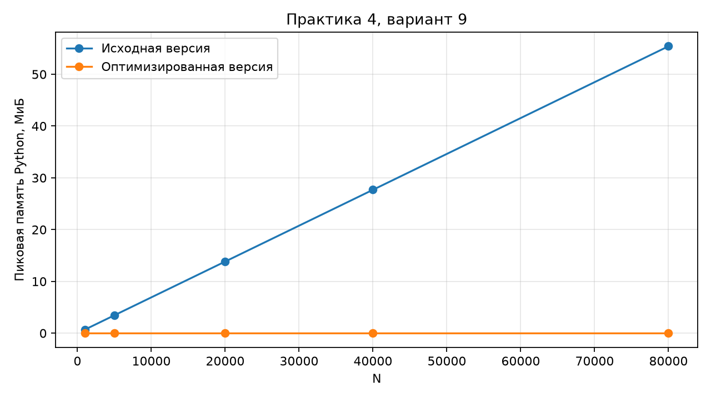

# Практическое занятие № 4. Вариант 9

**Выполнил: Ефремов А. ЭФБО-10-23**

**Дисциплина:** Оптимизация программного кода

**Тема:** Оптимизация использования памяти.

## Задача и исходный подход

Функция repeated_data создаёт N словарей с идентификатором, статусом, категорией, описанием и пятью случайными числами. Затем создаёт группы по статусу и помещает в них поверхностные копии словарей. Возвращаются только число записей и сумма чисел. Поля, группы и копии не используются в результате. Время O(N), дополнительная память O(N). Копия r.copy() создаёт новый словарь, но использует тот же список values.

## Условия измерений

Python 3.14.8, Linux-7.2.11-1-cachyos-x86_64-with-glibc2.44. random.seed(42); пять повторений, в таблицах медиана времени perf_counter без профилирования. Перед каждым повторением вызывается gc.collect(). Измерения версий выполнялись последовательно. Генерация входит в измеряемую функцию. Память измеряется отдельным вызовом через tracemalloc: пик отслеживаемых выделений Python и остаток после возврата функции, пока её результат ещё удерживается. Это не полная память процесса RSS.

## Базовые замеры

| N | Пик до, МиБ | После возврата, КиБ |
| --- | --- | --- |
| 1000 | 0.686 | 24.551 |
| 5000 | 3.456 | 24.551 |
| 20000 | 13.838 | 24.551 |
| 40000 | 27.694 | 24.551 |
| 80000 | 55.414 | 24.551 |

## Профилирование памяти

Построчное профилирование memory_profiler выявляет основные затраты на создание записей, списков значений и копий словарей.

| Строка | Структура | Причина расхода |
| --- | --- | --- |
| 16 | Списки values и случайные float | Пять чисел и список на каждую запись |
| 24 | Копии словарей и списки групп | N словарей r.copy() и ссылки на них |
| 11 | Исходные словари записей | Один словарь на каждую запись |
| 15 | Строки description | Повторяющиеся описания создаются N раз |
| 10 | Идентификаторы int | Хранятся в словарях |
| 18 | Список records | N ссылок на записи |

Построчное профилирование memory_profiler выполнено для обеих версий. В исходном прогоне RSS вырос примерно с 403,9 до 430,7 МиБ, в оптимизированном оставался около 405,1 МиБ. Прогоны проведены в одном процессе после tracemalloc; RSS включает библиотеки и удерживаемые аллокатором страницы, поэтому абсолютные уровни этих прогонов нельзя использовать как независимое сравнение. Основная сравнительная метрика ниже — отдельные измерения tracemalloc.

## План оптимизации и реализация

| Проблема | Изменение | Ожидаемый эффект |
| --- | --- | --- |
| Все records хранятся до конца | Обрабатывать данные потоком | O(N) → O(1) дополнительной памяти |
| Словари и повторяющиеся строки | Не создавать неиспользуемые поля | Устранить объекты записей и описаний |
| Копии r.copy() в groups | Убрать неиспользуемую группировку | Устранить N копий словарей |
| Список из пяти значений | Внутренний генератор для sum | Считать сумму записи без списка |

Сохранены два уровня sum: сначала сумма пяти чисел записи, затем сумма всех записей. Плоская сумма 5N чисел могла бы изменить округление. Количество возвращается через len(range(n)); это сохраняет нулевой результат для отрицательного N. Число и порядок вызовов random.random() сохранены. Время остаётся O(N), дополнительная память — O(1) в обычной модели вычислений.

## Проверка корректности

pytest: 11 тестов прошли. На обеих версиях проверены пустой и отрицательный размер. Для N = −3, 0, 1, 10, 100, 1000, 20000 проверены точное равенство результата и полное состояние генератора random. Сравнение выполняется без допуска для float.

## Повторные замеры

| N | Пик до, МиБ | Пик после, КиБ | Остаток до / после, КиБ | Снижение пика |
| --- | --- | --- | --- | --- |
| 1000 | 0.686 | 1.000 | 24.551 / 0.297 | 702× |
| 5000 | 3.456 | 1.000 | 24.551 / 0.297 | 3539× |
| 20000 | 13.838 | 1.000 | 24.551 / 0.297 | 14170× |
| 40000 | 27.694 | 1.000 | 24.551 / 0.297 | 28358× |
| 80000 | 55.414 | 1.000 | 24.551 / 0.297 | 56744× |

| N | Время до, с | Время после, с | Ускорение |
| --- | --- | --- | --- |
| 1000 | 0.001166 | 0.000616 | 1.89× |
| 5000 | 0.006501 | 0.003042 | 2.14× |
| 20000 | 0.035377 | 0.012043 | 2.94× |
| 40000 | 0.070438 | 0.024654 | 2.86× |
| 80000 | 0.151602 | 0.049109 | 3.09× |

## Вывод

Пиковые выделения Python при N = 80000 снизились с 55.414 МиБ до 1.000 КиБ. На всех пяти точках дополнительная память оптимизированной функции остаётся практически постоянной. Время уменьшилось с 0.151602 до 0.049109 с. Результат и состояние random сохранены точно. Большие коэффициенты экономии относятся к отслеживаемым выделениям внутри вызова, а не ко всей памяти процесса. Если понадобятся сами записи или группы, их хранение потребуется вернуть либо организовать отдельную потоковую обработку.
