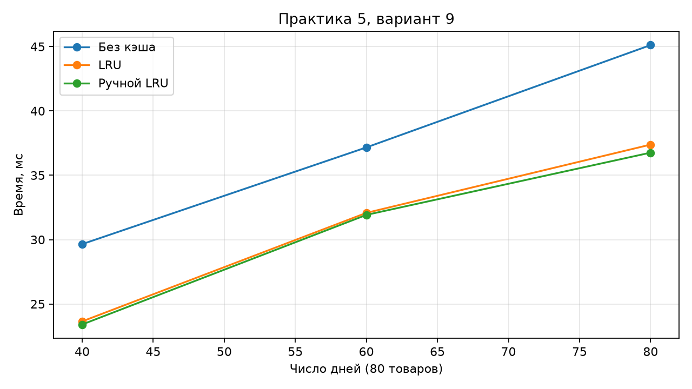
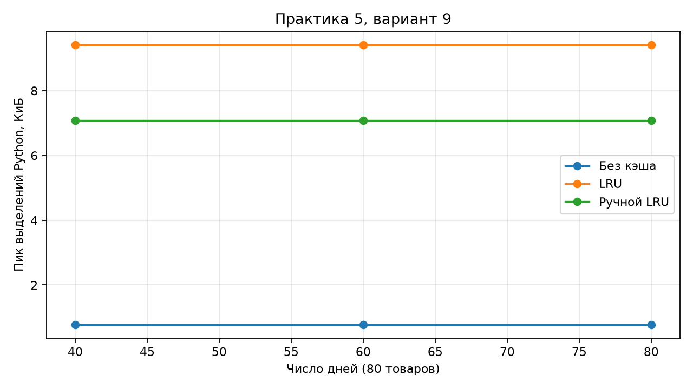

# Практическое занятие № 5. Вариант 9

**Выполнил: Ефремов А. ЭФБО-10-23**

**Дисциплина:** Оптимизация программного кода

**Тема:** Кэширование с ограничениями, инвалидацией и анализом компромиссов.

## Анализ исходного кода

Класс `Analytics` хранит продажи в словаре с ключом `(день, товар)`. Метод `daily_total` суммирует продажи за день, `product_total` — продажи товара за все дни. `summary_report` объединяет эти суммы. Каждый вызов заново обходит товары или дни и выполняет дополнительные циклы прибавления нуля. Для D дней и P товаров стоимость запроса по дню — O(P), по товару — O(D), отчёта — O(число выбранных дней · P + число выбранных товаров · D).

В исходной нагрузке создаются 40 случайных отчётов по 5 дням и 8 товарам, затем повторяются первые 20 отчётов. Это 780 запросов частичных итогов. Повторение отчёта не обязательно даёт попадание в небольшой кэш: между двумя обращениями нужный итог может быть вытеснен. После формирования отчётов меняются отдельные продажи через `update_sale`. Изменение продажи затрагивает итог её дня и итог её товара.

## Две стратегии кэширования

В обеих реализациях исходный расчёт суммы сохранён, включая дополнительные циклы. Измеряется эффект кэширования. Кэш хранится отдельно для каждого экземпляра.

| Стратегия | Ключ и значение | Ограничение и вытеснение | Инвалидация |
| --- | --- | --- | --- |
| `LruAnalytics` | `(тип итога, номер)` → сумма float | `functools.lru_cache(maxsize=32)`, вытесняется наименее недавно использованный ключ | После любого `update_sale` очищается весь кэш |
| `ManualAnalytics` | Такой же ключ → сумма float | `OrderedDict`, не больше 32 записей; попадание переносит ключ в конец, при переполнении удаляется первый | Удаляются только итог изменённого дня и итог изменённого товара |

32 записи покрывают небольшую рабочую область из 5 дней и 8 товаров с запасом и ограничивают рост памяти. Это лимит числа записей, а не точный бюджет в байтах. В заданной нагрузке ключи состоят из короткой строки и целого числа, значения — float, поэтому расход памяти ограничен небольшой величиной. На промахе сохраняется стоимость исходного расчёта; на попадании ожидаемая стоимость обращения O(1).

Основное различие при обновлении: стандартный LRU вызывает `self._cached.cache_clear()`. Ручной удаляет только два ключа:

```python
self._cache.pop(("day", day), None)
self._cache.pop(("product", product), None)
```

Данные нужно менять через `update_sale`. Прямое редактирование открытого словаря `sales` в обход этого метода не инвалидирует кэш. Отчёт создаётся заново при каждом запросе, поэтому изменение возвращённого словаря не повреждает сохранённые суммы.

## Методика измерений

Python 3.14.8, Linux, AMD Ryzen 7 4800H. Для каждой стратегии создаются одинаковые продажи с `random.seed(42)`, запросы строятся заранее отдельным генератором с seed 123. Время обработки — медиана пяти запусков с новым, ещё пустым кэшем. Создание исходного словаря продаж и генерация запросов не входят в замер. Перед каждым повторением вызывается `gc.collect()`.

Память измеряется отдельным прогоном через `tracemalloc` после создания объекта. «Пик» — максимум отслеживаемых выделений при обработке запросов; «удержано» — выделения, оставшиеся после серии запросов. Общая память исходного словаря и RSS процесса не включены. В каждой серии проверяется совпадение контрольной суммы результатов всех стратегий.

## Характерная нагрузка: случайные отчёты с повторением

Для 80 товаров проверены 40, 60 и 80 дней. В каждом случае выполняются 60 отчётов по схеме исходного задания.

| Дней | Стратегия | Время, мс | Пик, КиБ | Удержано, КиБ | Ускорение |
| --- | --- | --- | --- | --- | --- |
| 40 | Без кэша | 29.651 | 0.781 | 0.359 | 1.00× |
| 40 | LRU | 23.647 | 9.406 | 6.836 | 1.25× |
| 40 | Ручной LRU | 23.408 | 7.078 | 4.508 | 1.27× |
| 60 | Без кэша | 37.166 | 0.781 | 0.359 | 1.00× |
| 60 | LRU | 32.079 | 9.406 | 6.836 | 1.16× |
| 60 | Ручной LRU | 31.921 | 7.078 | 4.508 | 1.16× |
| 80 | Без кэша | 45.116 | 0.781 | 0.359 | 1.00× |
| 80 | LRU | 37.383 | 9.406 | 6.836 | 1.21× |
| 80 | Ручной LRU | 36.758 | 7.078 | 4.508 | 1.23× |





Ускорение умеренное: рабочая область из 120–160 возможных ключей существенно больше лимита 32, поэтому результаты часто вытесняются. Кэш требует дополнительной памяти, даже когда попаданий немного.

## Повторные запросы к небольшой рабочей области

40 отчётов обращаются только к 5 дням и 8 товарам; всего 13 различных ключей, все помещаются в кэш. Данные содержат 60 дней и 80 товаров.

| Стратегия | Время, мс | Пик, КиБ | Удержано, КиБ | Ускорение |
| --- | --- | --- | --- | --- |
| Без кэша | 24.093 | 0.781 | 0.359 | 1.00× |
| LRU | 0.826 | 2.930 | 2.508 | 29.15× |
| Ручной LRU | 0.935 | 1.992 | 1.570 | 25.77× |

После прогрева почти все обращения становятся попаданиями. Стандартная реализация LRU здесь немного быстрее ручной.

## Запросы с изменением продаж

Та же небольшая рабочая область, но перед каждым пятым отчётом обновляется одна продажа.

| Стратегия | Время, мс | Пик, КиБ | Удержано, КиБ | Ускорение |
| --- | --- | --- | --- | --- |
| Без кэша | 24.438 | 0.844 | 0.422 | 1.00× |
| LRU | 5.142 | 3.227 | 2.633 | 4.75× |
| Ручной LRU | 1.662 | 3.070 | 2.406 | 14.71× |

Полная очистка заставляет повторно вычислять все 13 итогов. Точечная инвалидация сохраняет незатронутые значения; ручной LRU в этой серии примерно втрое быстрее стандартного LRU.

## Когда кэш бесполезен

60 однократных запросов по разным дням и 80 однократных запросов по разным товарам. Повторных ключей нет.

| Стратегия | Время, мс | Пик, КиБ | Удержано, КиБ | Ускорение |
| --- | --- | --- | --- | --- |
| Без кэша | 6.995 | 0.781 | 0.359 | 1.00× |
| LRU | 7.130 | 9.469 | 6.898 | 0.98× |
| Ручной LRU | 7.262 | 7.078 | 4.508 | 0.96× |

Вычисления не переиспользуются. Кэш немного замедляет обработку и удерживает значения, которые больше не понадобятся.

## Проверка корректности

**8 тестов pytest прошли.** Проверены повторные отчёты, совпадение итогов с исходником после прогрева и нескольких изменений продаж, нулевые итоги для отсутствующих дней и товаров, ограничение размера и LRU-вытеснение, полная и точечная инвалидация, независимость экземпляров. Вычисляемые части ответа `run_task` совпадают с исходником; время выполнения сравнивать на равенство не требуется.

## Выбор и выводы

Для повторных запросов с изменениями выбран `ManualAnalytics`: небольшой ограниченный кэш и точечная инвалидация дают хороший баланс скорости и памяти. Его код длиннее, чем обёртка `lru_cache`, и требует правильно перечислять все затронутые ключи. Полная очистка стандартного LRU проще и надёжнее при сложных зависимостях; при редких обновлениях и частых попаданиях она предпочтительна.

В случайной нагрузке выигрыш составляет только 1.16–1.27 раза, поэтому кэш не следует вводить без анализа повторяемости. При однократных запросах лучше оставить исходный подход либо ускорить сам расчёт. Если нужны быстрые ответы при постоянных обновлениях, можно отдельно рассмотреть поддержание агрегатов дня и товара при записи; это другое изменение алгоритма, в этой работе оно не реализовано.
