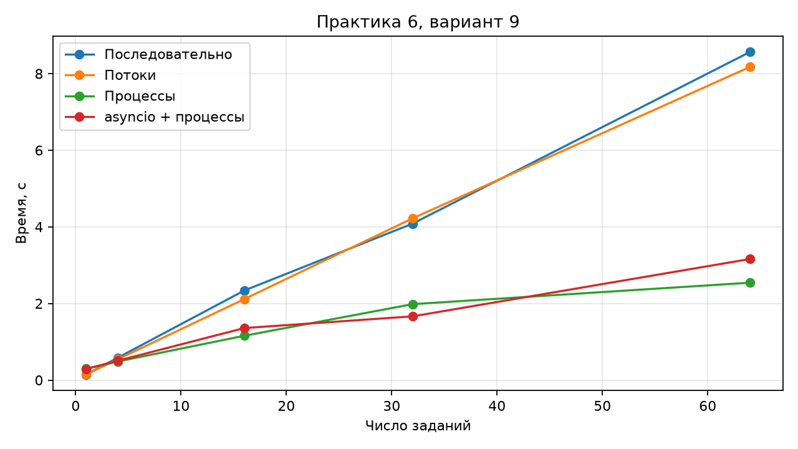
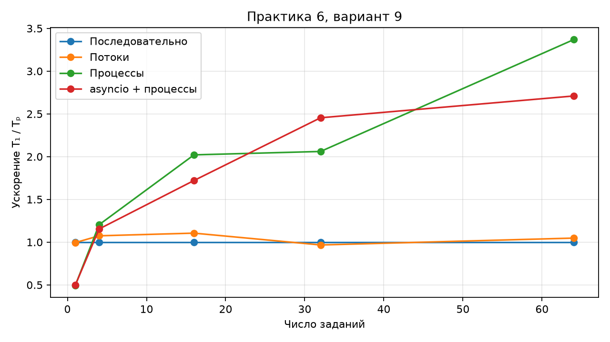

# Практическое занятие № 6. Вариант 9

**Выполнил: Ефремов А. ЭФБО-10-23**

**Дисциплина:** Оптимизация программного кода

**Тема:** Параллелизм, конкурентность и ограничения GIL.

## Условия измерений

Linux 7.2.11-1-cachyos, AMD Ryzen 7 4800H: 8 физических ядер, 16 логических процессоров. ОЗУ около 15 ГиБ. Python 3.14.8, GIL включён, JIT выключен. Видны все 16 логических процессоров. Другие бенчмарки одновременно не запускались; фоновые приложения пользователя не закрывались, поэтому в результатах возможны колебания нагрузки.

Перед измерением этапов выполнен общий прогрев моделей. Для каждого размера сначала прогреваются все четыре модели, затем выполняются пять повторений каждой с чередованием порядка; прогрев исключён. приводятся медиана и min–max времени `perf_counter` без профилировщика. Создание списка номеров заданий исключено из времени. Генерация чисел внутри неизменённого `stage_fetch` входит в этап работы и одинаково учитывается в эталоне и новых моделях. Создание и завершение пулов входит в замер.

Проверены нагрузки из `SCALES`: 1, 4, 8, то есть 4, 16, 32 задания. Добавлены один элемент и scale=16 — 64 задания.

## Характер нагрузки и зависимости

| Функция | Тип нагрузки | Можно ли выполнять параллельно |
| --- | --- | --- |
| `stage_fetch` / `stage_fetch_async` | Ожидание 30 мс и небольшая генерация списка | Задания независимы; ожидания можно перекрывать |
| `stage_cpu` | Вычисления: 12000 чисел, по 25 итераций с sin и cos | Независимы; процессы используют разные ядра, потоки ограничены GIL |
| `stage_post` | Вычисления: 400000 обновлений state | Между заданиями нельзя: каждое зависит от предыдущего состояния |

Исходные этапы и `run_sequential` не изменены. Единица независимой работы — загрузка и вычисление одного задания. Сборка выполняется в исходном порядке: перестановка `stage_post` меняет результат, поскольку обновление состояния нелинейно.

В процессной модели передаётся только целый номер задания; список из 12000 чисел создаётся внутри воркера, обратно возвращается float. В гибриде asyncio список создаётся в основном процессе и передаётся в пул: сериализованный список для задания 0 занимает 32970 байт без служебных сообщений. Это дополнительный расход передачи и памяти. Одно задание достаточно крупное для сравнения расходов запуска и полезных вычислений.

## Измерение этапов и предварительный прогноз

Перед сравнением моделей выполнен отдельный последовательный замер этапов: прогрев и пять повторений, в таблице медианы. `Fetch` включает ожидание и создание чисел; чистое заданное ожидание равно `0.03 × число заданий` секунд. Доля post принята за f для предварительной оценки Амдала: `S(p) ≤ 1 / (f + (1 − f) / p)`. Табличные S2, S4, S8 — ориентиры при постоянной скорости этапов, без запуска пулов и обмена данными.

| Заданий | Fetch, с | CPU, с | Post, с | Fetch, % | CPU, % | Post, % | S2 | S4 | S8 |
| --- | --- | --- | --- | --- | --- | --- | --- | --- | --- |
| 1 | 0.0359 | 0.0539 | 0.0563 | 24.6 | 36.9 | 38.6 | 1.44 | 1.85 | 2.16 |
| 4 | 0.1421 | 0.2160 | 0.2250 | 24.4 | 37.1 | 38.6 | 1.44 | 1.85 | 2.16 |
| 16 | 0.5707 | 0.8695 | 0.9014 | 24.4 | 37.1 | 38.5 | 1.44 | 1.86 | 2.17 |
| 32 | 1.1425 | 1.7462 | 1.8035 | 24.3 | 37.2 | 38.4 | 1.44 | 1.86 | 2.17 |
| 64 | 2.2884 | 3.4624 | 3.5968 | 24.5 | 37.0 | 38.5 | 1.44 | 1.86 | 2.17 |

По раздельным замерам вычислительные этапы CPU и Post занимают около 75.5 % времени, Fetch — около 24.5 %. Чистое заданное ожидание составляет примерно 20.5 % общего времени; оставшаяся часть Fetch — генерация данных. Для четырёх воркеров грубый ориентир Амдала — около 1.86 раза, для восьми — около 2.17 раза.

Прогноз до сравнения моделей: процессы должны помочь независимым вычислениям на достаточно большом входе; потоки смогут перекрыть ожидание, но ограничены GIL. Гибрид asyncio может выиграть на ожидании, однако передача списков и последовательные запросы к executor добавят расходы. Для одного задания лучший выбор — последовательный вызов.

## Реализованные модели

Все функции принимают список `jobs` и возвращают `(state, len(jobs))`, как эталон.

| Модель | Реализация | Число воркеров |
| --- | --- | --- |
| Последовательная | Исходная `run_sequential` | 1 |
| Потоки | `ThreadPoolExecutor.map` для загрузки и расчёта, `stage_post` в основном потоке | 4 |
| Процессы | `ProcessPoolExecutor.map`, загрузка и расчёт внутри воркера, `stage_post` в основном процессе | 4 |
| asyncio + процессы | Асинхронная загрузка, расчёт через `run_in_executor`, затем зависимые `stage_post` по очереди через executor | 4 процесса |

Использован способ запуска процессов `spawn`; функции воркеров определены на уровне модуля. Четыре процесса оставляют часть восьми физических ядер для основного процесса и других программ; больше воркеров не устраняет зависимость `stage_post`. Четыре потока позволяют перекрыть несколько ожиданий, но увеличение их числа не снимает ограничение GIL на вычисления. Это обоснованный фиксированный выбор для эксперимента, а не доказанный оптимум числа воркеров.

`map` и `gather` сохраняют порядок ответов. Потоки и процессы могут начать обработку состояния, пока следующие независимые расчёты ещё идут. Гибрид сначала собирает все промежуточные результаты и только затем обновляет состояние через executor: цикл событий не блокируется вычислениями, но конвейерное перекрытие этих этапов отсутствует.

## Корректность

**9 тестов pytest прошли.** Каждая из трёх новых моделей сравнена с эталоном на пустом списке, одном задании и `[2, 0, 2]`. Количество заданий совпадает точно, состояние сравнивается с относительным и абсолютным допуском `1e-12`. Бенчмарк дополнительно сравнивает ответы на всех пяти размерах. Общих изменяемых данных между потоками нет: генератор чисел локален для задания, состояние обновляется последовательно.

## Время, ускорение и эффективность

`S = T₁ / Tₚ`, `E = S / p`. Для трёх новых моделей p=4. В процессной модели основной процесс дополнительно считает `stage_post`, поэтому это эффективность относительно числа воркеров, а не точная загрузка всех использованных ядер.

| Заданий | Модель | Медиана, с | Min–max, с | S | E |
| --- | --- | --- | --- | --- | --- |
| 1 | Последовательно | 0.1459 | 0.1457–0.1477 | 1.00 | 1.00 |
| 1 | Потоки | 0.1466 | 0.1459–0.1478 | 0.99 | 0.25 |
| 1 | Процессы | 0.2941 | 0.2914–0.2950 | 0.50 | 0.12 |
| 1 | asyncio + процессы | 0.2920 | 0.2887–0.2935 | 0.50 | 0.12 |
| 4 | Последовательно | 0.5846 | 0.5829–0.5855 | 1.00 | 1.00 |
| 4 | Потоки | 0.5441 | 0.5378–0.5506 | 1.07 | 0.27 |
| 4 | Процессы | 0.4855 | 0.4785–0.4911 | 1.20 | 0.30 |
| 4 | asyncio + процессы | 0.5065 | 0.5026–0.5144 | 1.15 | 0.29 |
| 16 | Последовательно | 2.3375 | 1.6380–2.3417 | 1.00 | 1.00 |
| 16 | Потоки | 2.1143 | 1.5944–2.1519 | 1.11 | 0.28 |
| 16 | Процессы | 1.1566 | 0.7576–1.1586 | 2.02 | 0.51 |
| 16 | asyncio + процессы | 1.3581 | 0.9009–1.3697 | 1.72 | 0.43 |
| 32 | Последовательно | 4.0856 | 3.9530–4.3390 | 1.00 | 1.00 |
| 32 | Потоки | 4.2240 | 2.7412–4.2331 | 0.97 | 0.24 |
| 32 | Процессы | 1.9827 | 1.3357–2.0786 | 2.06 | 0.52 |
| 32 | asyncio + процессы | 1.6644 | 1.6281–2.4904 | 2.45 | 0.61 |
| 64 | Последовательно | 8.5630 | 8.3049–8.6694 | 1.00 | 1.00 |
| 64 | Потоки | 8.1739 | 5.4765–8.3572 | 1.05 | 0.26 |
| 64 | Процессы | 2.5420 | 2.5037–3.8802 | 3.37 | 0.84 |
| 64 | asyncio + процессы | 3.1602 | 3.1149–3.3500 | 2.71 | 0.68 |

## Анализ результатов

На 64 заданиях процессная модель сократила медиану с 8.5630 до 2.5420 с: ускорение 3.37 раза, эффективность 0.84. Гибрид дал 2.71 раза. На 32 заданиях быстрее оказался гибрид, что вместе с широкими диапазонами min–max показывает влияние условий запуска: одна модель не выигрывает на всех размерах. Качественный прогноз о пользе процессов на достаточно крупной нагрузке подтвердился.

Для одного задания конкурентность не даёт полезного перекрытия: потоки добавляют управление пулом, процессы и гибрид — запуск отдельных интерпретаторов. На больших наборах независимая часть достаточно велика, чтобы окупить эти расходы.

На 32 заданиях потоки оказались немного медленнее эталона; перекрытие ожиданий не гарантирует общего выигрыша. Потоки перекрывают ожидания загрузки, но `stage_cpu` и `stage_post` выполняют вычисления под GIL и конкурируют за него. Поэтому четыре потока не означают четырёхкратное ускорение. Процессы выполняют независимые расчёты на разных ядрах, а основной процесс по порядку обновляет состояние. Передача только номера задания и одного числа уменьшает расходы сериализации.

Гибрид asyncio использует асинхронную загрузку и процессы для вычислений; это не ускорение тяжёлых вычислений самим asyncio. Его расходы — передача списков, диспетчеризация executor и отдельные сообщения на последовательные обновления состояния. Кроме того, сначала собираются все промежуточные ответы, поэтому обновление состояния не перекрывается с ещё идущими расчётами. Это объясняет, почему наличие asyncio само по себе не гарантирует лучший результат.

Предварительная оценка Амдала правильно выделяет зависимый этап как ограничение, однако её численные значения нельзя считать точным прогнозом для этих пулов. Она предполагает постоянную скорость этапов и p одинаковых исполнителей. В процессной модели помимо четырёх воркеров считает основной процесс; этапы перекрываются конвейерно. При этом зависимый этап может перекрываться с независимыми расчётами следующих заданий, поэтому его доля не равна полностью последовательной фазе всей программы. Отдельная проверка также показала, что длительность `stage_post` в последовательной и процессной среде различается. Поэтому доля, измеренная отдельной последовательной серией, не является точной неизменной f для всех моделей. Это не нарушение закона Амдала, а ограничение приближённой модели. На результат также влияют запуск процессов, частота CPU, планирование и фоновая нагрузка.

Эффективность меньше единицы: часть работы остаётся последовательной, на малом наборе не хватает заданий для загрузки всех воркеров, а управление пулами и обмен данными требуют времени. Увеличение числа воркеров не устраняет эти причины. Отдельного перебора p в работе нет, поэтому монотонность эффективности при изменении p экспериментально не утверждается.

## Вывод

Для смешанной нагрузки с заметной независимой вычислительной частью выбран процессный вариант `run_processes`, который используется в `run_task`. На малом входе лучше последовательный вызов. Для преимущественно ожидающей нагрузки без тяжёлого расчёта достаточно потоков или asyncio; для чистой вычислительной работы Python нужны процессы либо иной способ снять ограничение GIL. Если почти всё время займёт зависимая цепочка `stage_post`, рост числа процессов даст мало пользы — потребуется менять алгоритм или постановку задачи.
