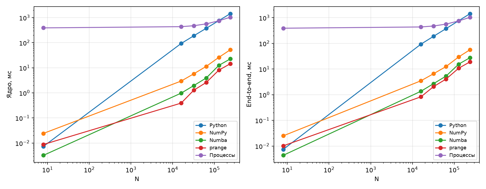
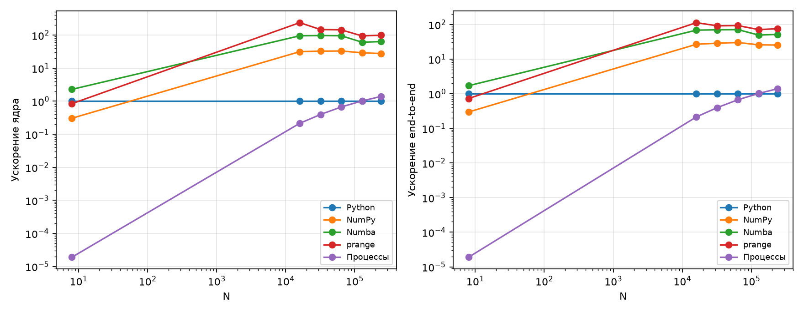
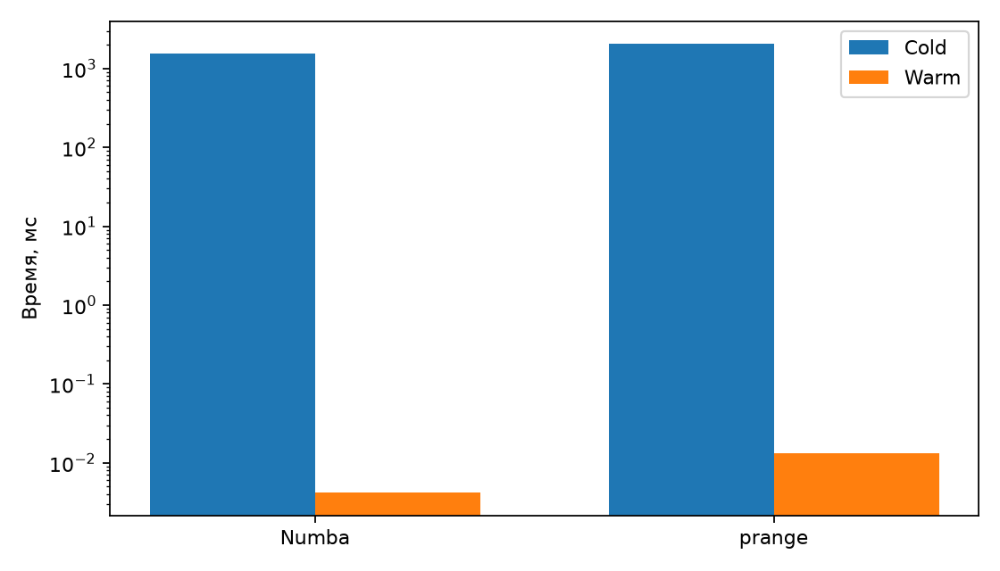
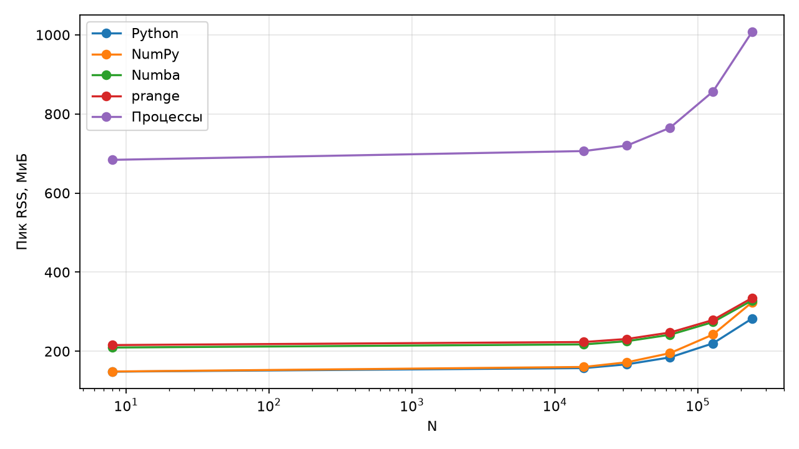

# Практическое занятие № 7. Вариант 9

**Выполнил: Ефремов А. ЭФБО-10-23**

**Дисциплина:** Оптимизация программного кода

**Тема:** Векторизация вычислений, NumPy и JIT-компиляция (Numba).

## Задача, нагрузка и прогноз

Исходная программа фильтрует одномерный сигнал ядром из пяти коэффициентов, нормализует результат в диапазон 0…1 и строит парные признаки. Для каждого i рассматриваются следующие максимум 29 элементов, записываются разность нормализованных значений и произведение нормализованного значения i на отфильтрованное значение j. Возвращаются три полных массива в фиксированном порядке.

Пусть M = N − K + 1 — длина отфильтрованного сигнала, K — длина ядра. Фильтрация требует O(NK), нормализация O(M), признаки O(M·WINDOW). В задании K=5 и WINDOW=30 постоянны, поэтому общая сложность O(N). Основное время занимают вложенные циклы формирования признаков и добавления чисел в array('d'). Между строками признаков нет зависимостей, но порядок их размещения в результате важен.

При M ≥ 30 число выходных значений признаков равно 58M − 870. Для N=240000 это 13918898 значений float64, около 106.2 МиБ только для признаков. Их хранение необходимо для сохранения полного результата; сравнение одной контрольной суммы не заменяет проверку массивов.

Прогноз по анализу кода: NumPy и прогретая Numba должны дать ускорение порядка десятков раз за счёт устранения Python-циклов. Numba сможет обойтись без больших промежуточных матриц, prange — распределить независимые строки. Процессы сохранят расходы интерпретации и добавят обмен большими результатами, поэтому ожидается существенно меньший выигрыш. На TINY и при первом JIT-вызове преимущество может исчезнуть.

## Реализованные подходы

| Версия | Реализация | Существенные расходы и условия |
| --- | --- | --- |
| Python | Исходный run_baseline без изменений | Списки Python, последовательные циклы, array('d') для признаков |
| NumPy | np.correlate, массивная нормализация, sliding_window_view и broadcasting | Представление окон не копирует данные, но арифметика создаёт временные массивы |
| Numba | @njit для фильтра, нормализации и циклов признаков | Первый вызов компилирует код, входы готовятся как непрерывные float64 |
| prange | Фильтр и нормализация последовательны, строки признаков распределяются между четырьмя потоками | Каждая строка имеет заранее вычисленный непересекающийся диапазон записи |
| Процессы | Фильтр и нормализация в родителе, признаки порциями через ProcessPoolExecutor | Четыре процесса spawn, пересылка данных и результатов, сборка порций |

У NumPy полный прямоугольник окон обрабатывается массивными операциями; только короткий хвост не более 29 строк обрабатывается циклом. Матрица всех N² пар не создаётся. Для процессов добавлен правый ореол до 29 элементов к каждой порции: он нужен для расчёта её последних строк. В выход попадают только собственные строки порции; pool.map сохраняет их порядок.

У prange нет общего изменяемого индекса записи: позиция вычисляется по номеру строки. Суммирование фильтра и нормализация выполняются до параллельного этапа, поэтому изменения порядка суммирования между потоками здесь нет. fastmath не включён. nogil=True не требуется: расчёт не запускается из нескольких Python-потоков, параллелизм создаёт сама Numba.

## Среда и методика

Linux 7.3.4-1-cachyos, AMD Ryzen 7 4800H, 8 физических и 16 логических ядер, ОЗУ 14.98 ГиБ. Python 3.14.10, NumPy 2.5.5, Numba 0.68.1. Numba использует 4 потока, BLAS — 1 поток. Использованы совместимые версии библиотек. Сведения о поддерживаемых версиях публикуются в [документации Numba](https://numba.readthedocs.io/en/stable/user/installing.html).

Время измеряется perf_counter: прогрев исключён, затем пять повторов, приведены медиана и min–max. Быстрые функции выполняются пакетами до 1000 вызовов на повтор, время делится на число вызовов. Генерация сигнала и проверка результата исключены; выделение и освобождение выходных массивов входят. Рабочая нагрузка детерминирована исходным Random(37).

Режим «ядро» получает уже подготовленные ndarray; end-to-end получает исходные списки, включая преобразование в непрерывные float64-массивы. Для Python и процессов собственный формат — списки, поэтому два режима совпадают и в таблице повторён один замер. Запуск и остановка пула, передача и сборка данных входят во время процессов. Cold Numba измеряется в отдельных свежих процессах для каждой версии, на заранее подготовленном TINY. Дисковый кеш JIT не используется.

Взяты TINY=8 и все пять SIZES: 16000, 32000, 64000, 128000, 240000. На наибольшем размере все ускоренные ядра работают дольше 1 мс, поэтому дополнительные размеры по условию методички не требуются.

## Время и ускорение

В ячейках времени: медиана (min–max), миллисекунды. S = T_Python / T_версии. Все три выходных массива каждой версии перед измерением сравниваются с эталоном.

| N | Метод | Ядро, мс (min–max) | E2E, мс (min–max) | S ядра | S E2E |
| --- | --- | --- | --- | --- | --- |
| 8 | Python | 0.0074 (0.0073–0.0075) | 0.0074 (0.0073–0.0075) | 1.00 | 1.00 |
| 8 | NumPy | 0.0243 (0.0242–0.0246) | 0.0250 (0.0246–0.0254) | 0.30 | 0.30 |
| 8 | Numba | 0.0032 (0.0032–0.0033) | 0.0043 (0.0043–0.0045) | 2.28 | 1.70 |
| 8 | prange | 0.0088 (0.0085–0.0099) | 0.0102 (0.0095–0.0109) | 0.84 | 0.72 |
| 8 | Процессы | 390.0563 (389.2363–393.9910) | 390.0563 (389.2363–393.9910) | 0.000019 | 0.000019 |
| 16000 | Python | 93.2744 (93.0146–93.5804) | 93.2744 (93.0146–93.5804) | 1.00 | 1.00 |
| 16000 | NumPy | 2.9623 (2.8072–3.1202) | 3.4892 (3.3383–3.6775) | 31.49 | 26.73 |
| 16000 | Numba | 0.9787 (0.9330–1.0041) | 1.3636 (1.3267–1.4246) | 95.30 | 68.40 |
| 16000 | prange | 0.3918 (0.3545–0.5941) | 0.8289 (0.7113–1.0399) | 238.04 | 112.52 |
| 16000 | Процессы | 436.2550 (431.4697–441.0883) | 436.2550 (431.4697–441.0883) | 0.21 | 0.21 |
| 32000 | Python | 188.1484 (184.9009–191.6199) | 188.1484 (184.9009–191.6199) | 1.00 | 1.00 |
| 32000 | NumPy | 5.7495 (5.6771–6.2821) | 6.5578 (6.3459–7.2560) | 32.72 | 28.69 |
| 32000 | Numba | 1.9488 (1.8746–2.0381) | 2.6934 (2.5481–2.8896) | 96.55 | 69.86 |
| 32000 | prange | 1.2752 (1.1176–1.4788) | 2.0626 (2.0083–2.3556) | 147.54 | 91.22 |
| 32000 | Процессы | 475.6962 (475.0530–482.6773) | 475.6962 (475.0530–482.6773) | 0.40 | 0.40 |
| 64000 | Python | 376.9770 (373.8311–384.3353) | 376.9770 (373.8311–384.3353) | 1.00 | 1.00 |
| 64000 | NumPy | 11.4285 (10.6191–13.2489) | 12.5426 (12.0510–13.9908) | 32.99 | 30.06 |
| 64000 | Numba | 3.9458 (3.6850–4.4771) | 5.3247 (5.0805–5.5757) | 95.54 | 70.80 |
| 64000 | prange | 2.6151 (2.5826–2.7970) | 4.0789 (3.9129–4.9629) | 144.15 | 92.42 |
| 64000 | Процессы | 563.6632 (560.2218–570.3795) | 563.6632 (560.2218–570.3795) | 0.67 | 0.67 |
| 128000 | Python | 761.8278 (759.0668–766.1321) | 761.8278 (759.0668–766.1321) | 1.00 | 1.00 |
| 128000 | NumPy | 26.1494 (25.2440–27.7383) | 29.6106 (27.8916–30.8313) | 29.13 | 25.73 |
| 128000 | Numba | 12.5095 (12.1002–13.3353) | 15.4857 (15.1337–15.9026) | 60.90 | 49.20 |
| 128000 | prange | 8.0788 (7.3988–9.3076) | 10.7358 (10.0502–13.4573) | 94.30 | 70.96 |
| 128000 | Процессы | 748.9335 (746.3460–757.2557) | 748.9335 (746.3460–757.2557) | 1.02 | 1.02 |
| 240000 | Python | 1436.6196 (1430.9691–1456.3475) | 1436.6196 (1430.9691–1456.3475) | 1.00 | 1.00 |
| 240000 | NumPy | 52.0393 (49.9651–52.2558) | 56.6705 (55.3281–58.1069) | 27.61 | 25.35 |
| 240000 | Numba | 22.5809 (22.1496–23.3264) | 27.7993 (27.3659–28.2578) | 63.62 | 51.68 |
| 240000 | prange | 14.4681 (13.7566–18.6858) | 19.1140 (17.3725–21.9338) | 99.30 | 75.16 |
| 240000 | Процессы | 1035.1887 (1028.9368–1044.9923) | 1035.1887 (1028.9368–1044.9923) | 1.39 | 1.39 |

При увеличении N с 16000 до 240000 в 15 раз время baseline выросло примерно в 15.4 раза, что согласуется с O(N). Степень сложности ускоренных версий не меняется: уменьшается стоимость обработки элемента. Рост не идеально пропорционален N из-за кешей CPU, выделения массивов, пропускной способности памяти и шума измерений.

На N=240000 Python занимает 1436.6196 мс, NumPy end-to-end — 56.6705 мс, Numba — 27.7993 мс, prange — 19.1140 мс. Ускорение полной обработки: 25.35, 51.68 и 75.16 раза соответственно. Процессы дают только 1.39 раза. Преобразование списков уменьшает выигрыш: для Numba ядро занимает 22.5809 мс, для prange — 14.4681 мс. Разность медиан разных серий лишь приблизительно оценивает цену преобразования, а не является отдельным точным замером этого этапа.

## Параллельная Numba относительно однопоточной

S_Numba = T_Numba / T_prange, E = S_Numba / 4. Используются времена ядра; сравнение с Python выше — другая метрика.

| N | Потоков | S к Numba | E |
| --- | --- | --- | --- |
| 8 | 4 | 0.3693 | 0.0923 |
| 16000 | 4 | 2.4977 | 0.6244 |
| 32000 | 4 | 1.5282 | 0.3821 |
| 64000 | 4 | 1.5088 | 0.3772 |
| 128000 | 4 | 1.5484 | 0.3871 |
| 240000 | 4 | 1.5607 | 0.3902 |

На больших размерах ускорение относительно однопоточной Numba около 1.5–1.6 раза, а не четыре. Фильтр и нормализация остаются последовательными; создание и запись большого массива ограничиваются памятью, а управление потоками требует времени. На малом размере распараллеливание не окупается. Результат при изменении числа потоков сохраняется, поскольку строки пишут в разные участки и не выполняют общую редукцию.

## Cold и warm

| Метод | Cold, мс | Warm, мс | Warm min–max, мс |
| --- | --- | --- | --- |
| Numba | 1546.9377 | 0.004161 | 0.004146–0.004224 |
| prange | 2054.1203 | 0.013080 | 0.012713–0.013324 |

Первый вызов включает определение типов, компиляцию машинного кода и для parallel-версии подготовку параллельного выполнения. Это примерно 1.55 и 2.05 с. Warm той же функции в том же свежем процессе измеряется микросекундами. При однократном маленьком запуске стоимость компиляции многократно превышает полезную работу. Цифры warm в этой таблице и основном эксперименте получены разными сериями, поэтому могут немного различаться.

## Пиковая память

Используется внешний счётчик текущей RSS процесса с шагом 5 мс в отдельном свежем процессе на каждый подход и размер. Проверка на массиве из 8388608 float64, заполненном единицами, увеличила RSS с 142233600 до 209346560 байт — примерно на 64 МиБ. Она подтверждает, что счётчик видит выделенную и реально затронутую память NumPy. Короткие пики между отсчётами могут быть пропущены.

Ниже полный RSS: интерпретатор, библиотеки, входы, результаты и временные объекты. Для Numba включён прогрев с компиляцией, поэтому это не отдельная оценка памяти только тёплого ядра. Общий измерительный модуль импортирует NumPy и Numba даже для baseline, что повышает базовый уровень RSS. Для процессов суммируется RSS родителя и потомков; разделяемые страницы могут учитываться несколько раз, это не уникальный объём физической памяти.

| N | Python, МиБ | NumPy, МиБ | Numba, МиБ | prange, МиБ | Процессы, МиБ |
| --- | --- | --- | --- | --- | --- |
| 8 | 148.434 | 148.785 | 209.387 | 215.629 | 683.949 |
| 16000 | 157.359 | 160.285 | 217.324 | 223.379 | 706.156 |
| 32000 | 166.949 | 172.168 | 225.449 | 231.098 | 720.082 |
| 64000 | 184.496 | 195.207 | 241.684 | 247.328 | 765.000 |
| 128000 | 220.004 | 242.254 | 273.754 | 279.031 | 856.746 |
| 240000 | 282.641 | 323.734 | 328.508 | 334.566 | 1007.320 |

На наибольшем размере NumPy использует больше RSS, чем Python: 323.734 против 282.641 МиБ. Векторные выражения для признаков создают временный массив примерно (N−33)×29 значений, около 53.1 МиБ, сверх выходных массивов. Представление sliding_window_view само исходные данные не копирует. Последовательная Numba заполняет выход напрямую, однако полный RSS включает компилятор и потому всё равно выше baseline. Рост полного RSS не следует путать с объёмом только данных.

У процессов примерно 1007 МиБ суммарной RSS на N=240000. Значения зависят и от импорта общего модуля в воркерах, и от буферов пересылки. Более лёгкий отдельный модуль воркера уменьшил бы фиксированные издержки, но передача больших результатов и работа с объектами Python остались бы.

## Корректность и устойчивость

**44 теста pytest прошли.** Проверяются полные filtered, normed и feats для всех четырёх новых версий на TINY, 16000 и 32000; три последовательных одинаковых запуска; минимальный допустимый размер; постоянные сигналы; несимметричный и пустой фильтр; слишком короткий вход с ValueError; подготовка float32 и непрерывных float64 из среза; отсутствие изменения входа; результаты при 1, 2 и 4 потоках prange; сводка run_task. Во время бенчмарка полные результаты дополнительно проверены на всех пяти рабочих размерах.

Для сравнения с baseline используются rtol=1e-11 и atol=1e-12: |a−b| ≤ atol + rtol·|b|. Способ сложения float в Python 3.14, NumPy и машинном коде Numba может различаться, поэтому побитовое равенство между разными подходами не требуется. Для повторных вызовов одной версии применяется строгое равенство массивов. Рассматриваются одномерные конечные вещественные входы без переполнения промежуточных вычислений; специальные значения NaN/inf не включены в заявленный контракт проверок.

## Негативные случаи и порог окупаемости

На TINY Python требует 0.0074 мс, NumPy end-to-end — 0.0250 мс, prange — 0.0102 мс. NumPy медленнее примерно в 3.4 раза: вызовы нескольких массивных операций дороже обработки нескольких значений в Python. Prange проигрывает на запуске параллельной работы. Процессы занимают около 390 мс вместо 7.4 мкс; S составляет около 0.000019.

Для NumPy тёплый порог окупаемости находится между проверенными N=8 и N=16000; точное N* не измерялось. У последовательной Numba warm уже есть выигрыш на TINY, но первый JIT-вызов там не оправдан. Cold и warm имеют разные условия окупаемости.

## Выводы и выбор инструмента

Прогноз о преимуществе NumPy и прогретой Numba подтвердился: на большом размере они дают десятки раз ускорения при той же O(N). Доминирует устранение интерпретации многочисленных простых операций и упаковки чисел Python. Это подтверждается уже однопоточной Numba: ускорение её ядра 63.62 раза, тогда как добавление четырёх потоков даёт ещё только 1.56 раза. Процессы не устраняют динамические операции Python и добавляют сериализацию и сборку большого массива.

NumPy удобен, когда задача естественно выражается массивными операциями и временные массивы допустимы. Numba полезна для численных циклов, которые неудобно векторизовать или нужно выполнять без крупных временных массивов; для повторной большой обработки этого варианта выбран run_numba, а prange — вариант для минимизации времени при доступных ядрах. Для одной маленькой задачи разумнее Python, для разовой крупной — NumPy без цены JIT. Процессы подходят для крупных независимых задач, которые нельзя эффективно выразить через массивы или JIT, при небольшом обмене данными. Потоки и asyncio полезны преимущественно для ожиданий; здесь искусственного ожидания нет.

Ограничения: требования к типам и непрерывности входов, стоимость преобразований и компиляции, дополнительные массивы NumPy, более сложная отладка Numba, объём полного результата, зависимость от числа ядер, версий библиотек и состояния памяти. fastmath мог бы изменить точность и обработку особых значений; в этой работе он не используется.
