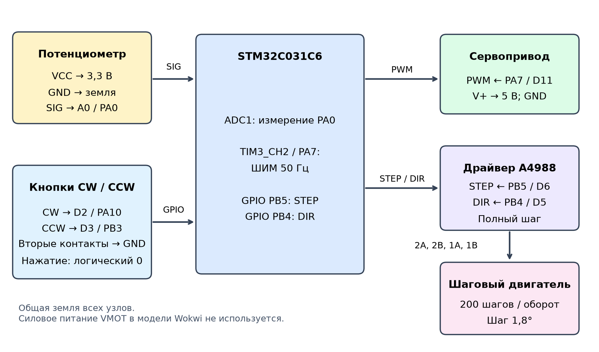
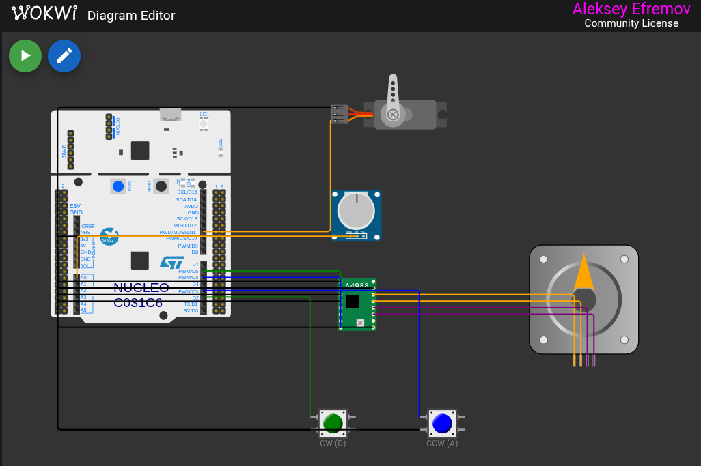
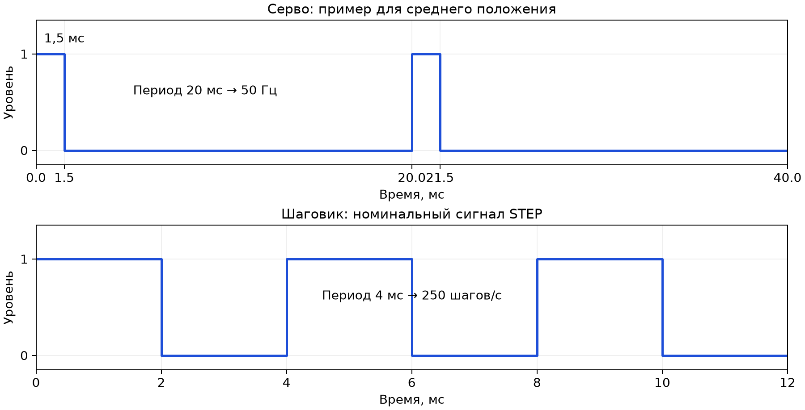

# Практическая работа №5

**Тема:** Принцип работы функциональных устройств. Управление сервоприводом и шаговым двигателем

## Содержание

## Введение

Исполнительные устройства преобразуют управляющие сигналы микроконтроллера в механическое движение. Для позиционирования применяются сервоприводы и шаговые двигатели. Эти устройства различаются способом задания движения: сервоприводу передаётся требуемое положение вала, а шаговому двигателю — последовательность команд на отдельные перемещения.

Цель работы — изучить принципы управления сервоприводом и шаговым двигателем и разработать программу их совместного управления на STM32 с использованием библиотеки HAL.

В работе используется модель платы Nucleo-C031C6 в Wokwi. Положение сервопривода задаётся потенциометром, направление и запуск шагового двигателя — двумя кнопками. Программа написана на языке C.

## 1 Теоретические сведения

### 1.1 Сервопривод

Малогабаритный позиционный сервопривод содержит электродвигатель, редуктор, датчик положения и встроенный регулятор. Регулятор сравнивает заданное положение с фактическим и управляет двигателем до уменьшения ошибки. Поэтому микроконтроллеру не требуется самостоятельно коммутировать обмотки двигателя или реализовывать внутренний контур регулирования.

У модели сервопривода Wokwi имеются три контакта: V+ для питания 5 В, GND и управляющий PWM. Диапазон механического перемещения составляет от 0° до 180° [1]. Положение задаётся длительностью положительного импульса внутри повторяющегося периода. В данной программе выбран период 20 мс и длительности от 500 до 2500 мкс. Для физического сервопривода допустимые границы уточняются по его документации.

```text
T = 20 мс
f = 1 / T = 50 Гц
```

В отличие от регулирования яркости светодиода, здесь существенна абсолютная длительность импульса, соответствующая заданному положению. Период сигнала сохраняется постоянным.

### 1.2 Шаговый двигатель и драйвер A4988

Шаговый двигатель перемещает ротор на определённый угол при изменении состояния обмоток. Для биполярного двигателя требуется менять направление тока в двух обмотках. Эту задачу выполняет силовой драйвер; GPIO микроконтроллера передают ему только управляющие сигналы.

В модели Wokwi один полный шаг соответствует 1,8°, то есть для оборота на 360° требуется 200 шагов [2]. Драйвер A4988 имеет вход STEP, положительный фронт которого задаёт очередной шаг, и вход DIR для выбора направления. При DIR = 1 модель вращается по часовой стрелке, при DIR = 0 — против часовой. Вход ENABLE активен низким уровнем, а RESET и SLEEP для работы должны находиться в высоком состоянии [3].

Входы MS1, MS2 и MS3 определяют режим дробления шага. В данной работе все три входа соединены с землёй, поэтому выбран полный шаг. Число управляющих импульсов определяет перемещение, а их частота — скорость вращения.

```text
Угол перемещения = N × 1,8°
Скорость, об/мин = fSTEP × 60 / 200
```

Без внешнего датчика программа не измеряет реальное положение вала. Для физического двигателя необходимо учитывать возможные пропуски шагов под нагрузкой.

### 1.3 Таймер, АЦП и дискретные входы STM32

Сигнал сервопривода формирует аппаратный таймер TIM3. Предделитель PSC задаёт частоту счётчика, регистр ARR — период, регистр CCR2 — длительность активного состояния второго канала. После запуска таймер генерирует импульсы независимо от основного цикла программы.

Потенциометр подключается между питанием 3,3 В и землёй. Напряжение на его среднем выводе поступает на АЦП. При 12-разрядном преобразовании используется диапазон результатов от 0 до 4095, который программа пересчитывает в длительность импульса.

Для кнопок используются цифровые входы с внутренней подтяжкой вверх. В отпущенном состоянии считывается единица, при замыкании кнопки на землю — ноль. В модели кнопок Wokwi дребезг отключён параметром bounce, равным нулю [4].

## 2 Практическая реализация

### 2.1 Состав и схема подключения

В проект входят плата Nucleo-C031C6, сервопривод, потенциометр, биполярный шаговый двигатель, драйвер A4988 и две кнопки. Модель STM32C031C6 поддерживает GPIO, АЦП, SysTick и TIM3, необходимые для реализации [5].

На рисунке приведена функциональная схема управления, составленная по фактическим соединениям diagram.json. Это схема проекта, а не снимок запущенной симуляции.



На следующем рисунке показана эта схема в редакторе Wokwi: плата Nucleo-C031C6, сервопривод, потенциометр, драйвер A4988, шаговый двигатель и две кнопки управления.



Подключение органов управления и сервопривода выполнено следующим образом:

- PWM сервопривода подключён к D11 / PA7, соответствующему TIM3_CH2 с альтернативной функцией AF1; V+ — к 5 В, GND — к общей земле;
- SIG потенциометра соединён с A0 / PA0 / ADC1_IN0, крайние контакты — с 3,3 В и GND;
- первый контакт кнопки CW соединён с D2 / PA10, второй — с GND;
- первый контакт кнопки CCW соединён с D3 / PB3, второй — с GND.

Вход STEP драйвера A4988 соединён с D6 / PB5, вход DIR — с D5 / PB4. Контакты VDD, RESET и SLEEP подключены к 3,3 В. Оба контакта GND, ENABLE и MS1–MS3 соединены с общей землёй. Выходы драйвера подключены к двигателю: 2B — A−, 2A — A+, 1A — B+, 1B — B−.

Контакт VMOT в схеме оставлен неподключённым, поскольку Wokwi не использует его для моделирования силового питания [3]. Эта особенность относится к симулятору. На физическом стенде необходимы питание двигателя и настройка ограничения тока согласно документации драйвера.

### 2.2 Расчёт сигнала сервопривода

В программе выбран внутренний источник HSI 48 МГц, делители AHB и APB1 равны единице. При PSC = 47 счётчик TIM3 работает с частотой 1 МГц, поэтому один отсчёт занимает 1 мкс. Значение ARR = 19999 задаёт 20000 отсчётов в периоде.

```text
Fcnt = 48 000 000 / (47 + 1) = 1 000 000 Гц
Fpwm = 1 000 000 / (19999 + 1) = 50 Гц
Tpwm = 20 мс
```

Канал TIM3_CH2 настроен в режиме PWM1 с активным высоким уровнем. Начальное значение сравнения составляет 1500, то есть 1,5 мс. После запуска канала основной цикл обновляет длительность по показанию потенциометра:

```text
CCR2 = 500 + 2000 × value / 4095
```

Минимум АЦП даёт импульс 500 мкс, середина диапазона — приблизительно 1500 мкс, максимум — 2500 мкс. Измерения выполняются примерно каждые 20 мс. Если преобразование не завершается за заданное предельное время ожидания, сохраняется предыдущее значение сравнения.



Диаграммы показывают номинальные интервалы, рассчитанные по настройкам программы; они не являются результатом измерения логическим анализатором.

### 2.3 Управление шаговым двигателем

Функция Stepper_Update вызывается из основного цикла. Она считывает обе кнопки и выбирает действие. Одна нажатая CW задаёт высокий DIR, одна нажатая CCW — низкий DIR. Если отпущены обе кнопки или нажаты обе одновременно, STEP принудительно устанавливается в ноль и новые шаги не формируются.

Во время движения STEP переключается примерно каждые 2 мс. Положительный фронт повторяется раз в 4 мс, поэтому номинальная частота составляет 250 шагов в секунду. При полном шаге получается следующая скорость:

```text
TSTEP = 2 + 2 = 4 мс
fSTEP = 1000 / 4 = 250 Гц
n = 250 × 60 / 200 = 75 об/мин
```

Частота STEP формируется программным опросом SysTick, поэтому измерение АЦП и выполнение цикла могут немного увеличить интервалы. При смене направления функция сначала переводит STEP в ноль, изменяет DIR и выдерживает интервал перед следующим фронтом. При остановке драйвер остаётся включённым: прекращение импульсов не равнозначно отключению его выходов.

### 2.4 Программа на языке C

В функции main выполняются инициализация HAL, тактирования, GPIO, АЦП и TIM3, затем запускается второй канал ШИМ. Основной цикл периодически считывает потенциометр и обновляет CCR2, а также обслуживает шаговый двигатель. Непрерывный сигнал сервопривода формируется аппаратно и не прекращается при обработке кнопок.

Полный фактический исходник main.c приведён ниже.

```c
#include "stm32c0xx_hal.h"

#define SERVO_Pin GPIO_PIN_7     // D11 / PA7 / TIM3_CH2 (AF1)
#define POT_Pin GPIO_PIN_0       // A0 / PA0 / ADC_IN0
#define CW_Pin GPIO_PIN_10       // D2 / PA10, button to GND
#define CCW_Pin GPIO_PIN_3       // D3 / PB3, button to GND
#define STEP_Pin GPIO_PIN_5      // D6 / PB5 -> A4988 STEP
#define DIR_Pin GPIO_PIN_4       // D5 / PB4 -> A4988 DIR
#define SERVO_PERIOD_US 20000U   // 50 Hz
#define SERVO_MIN_US 500U
#define SERVO_MAX_US 2500U
#define STEP_HALF_PERIOD_MS 2U   // 250 steps/s, 200 steps/revolution

ADC_HandleTypeDef hadc1;
TIM_HandleTypeDef htim3;

static void SystemClock_Config(void);
static void MX_GPIO_Init(void);
static void MX_ADC1_Init(void);
static void MX_TIM3_Init(void);

/* Change direction with STEP low, then wait before the next pulse. */
static void Stepper_Update(uint32_t now) {
  static uint32_t changed_at = 0;
  static GPIO_PinState step = GPIO_PIN_RESET;
  static GPIO_PinState direction = GPIO_PIN_RESET;
  uint8_t cw = HAL_GPIO_ReadPin(GPIOA, CW_Pin) == GPIO_PIN_RESET;
  uint8_t ccw = HAL_GPIO_ReadPin(GPIOB, CCW_Pin) == GPIO_PIN_RESET;

  /* Both released or both pressed: stop. */
  if (cw == ccw) {
    step = GPIO_PIN_RESET;
    HAL_GPIO_WritePin(GPIOB, STEP_Pin, step);
    changed_at = now;
    return;
  }

  GPIO_PinState requested = cw ? GPIO_PIN_SET : GPIO_PIN_RESET;
  if (requested != direction) {
    step = GPIO_PIN_RESET;
    HAL_GPIO_WritePin(GPIOB, STEP_Pin, step);
    direction = requested;
    HAL_GPIO_WritePin(GPIOB, DIR_Pin, direction);
    changed_at = now;
    return;
  }

  if ((uint32_t)(now - changed_at) >= STEP_HALF_PERIOD_MS) {
    changed_at = now;
    step = (step == GPIO_PIN_RESET) ? GPIO_PIN_SET : GPIO_PIN_RESET;
    HAL_GPIO_WritePin(GPIOB, STEP_Pin, step);
  }
}

int main(void) {
  HAL_Init();
  SystemClock_Config();
  MX_GPIO_Init();
  MX_ADC1_Init();
  MX_TIM3_Init();
  HAL_TIM_PWM_Start(&htim3, TIM_CHANNEL_2);

  uint32_t sampled_at = HAL_GetTick() - 20U;
  while (1) {
    uint32_t now = HAL_GetTick();
    if ((uint32_t)(now - sampled_at) >= 20U) {
      sampled_at = now;
      HAL_ADC_Start(&hadc1);
      if (HAL_ADC_PollForConversion(&hadc1, 2U) == HAL_OK) {
        uint32_t value = HAL_ADC_GetValue(&hadc1);
        uint32_t pulse = SERVO_MIN_US +
            (SERVO_MAX_US - SERVO_MIN_US) * value / 4095U;
        __HAL_TIM_SET_COMPARE(&htim3, TIM_CHANNEL_2, pulse);
      }
      HAL_ADC_Stop(&hadc1);
    }

    Stepper_Update(HAL_GetTick());
    HAL_Delay(1U);
  }
}

static void MX_ADC1_Init(void) {
  ADC_ChannelConfTypeDef channel = {0};
  __HAL_RCC_ADC_CLK_ENABLE();

  hadc1.Instance = ADC1;
  hadc1.Init.ClockPrescaler = ADC_CLOCK_SYNC_PCLK_DIV4;
  hadc1.Init.Resolution = ADC_RESOLUTION_12B;
  hadc1.Init.DataAlign = ADC_DATAALIGN_RIGHT;
  hadc1.Init.ScanConvMode = ADC_SCAN_SEQ_FIXED;
  hadc1.Init.EOCSelection = ADC_EOC_SINGLE_CONV;
  hadc1.Init.LowPowerAutoWait = DISABLE;
  hadc1.Init.LowPowerAutoPowerOff = DISABLE;
  hadc1.Init.ContinuousConvMode = DISABLE;
  hadc1.Init.NbrOfConversion = 1;
  hadc1.Init.DiscontinuousConvMode = DISABLE;
  hadc1.Init.ExternalTrigConv = ADC_SOFTWARE_START;
  hadc1.Init.ExternalTrigConvEdge = ADC_EXTERNALTRIGCONVEDGE_NONE;
  hadc1.Init.DMAContinuousRequests = DISABLE;
  hadc1.Init.Overrun = ADC_OVR_DATA_PRESERVED;
  hadc1.Init.SamplingTimeCommon1 = ADC_SAMPLETIME_39CYCLES_5;
  hadc1.Init.SamplingTimeCommon2 = ADC_SAMPLETIME_39CYCLES_5;
  hadc1.Init.OversamplingMode = DISABLE;
  HAL_ADC_Init(&hadc1);

  channel.Channel = ADC_CHANNEL_0;
  channel.Rank = ADC_RANK_CHANNEL_NUMBER;
  channel.SamplingTime = ADC_SAMPLINGTIME_COMMON_1;
  HAL_ADC_ConfigChannel(&hadc1, &channel);
  HAL_ADCEx_Calibration_Start(&hadc1);
}

static void MX_TIM3_Init(void) {
  TIM_OC_InitTypeDef channel = {0};
  __HAL_RCC_TIM3_CLK_ENABLE();

  htim3.Instance = TIM3;
  htim3.Init.Prescaler = 48 - 1;             // 48 МГц -> 1 МГц
  htim3.Init.CounterMode = TIM_COUNTERMODE_UP;
  htim3.Init.Period = SERVO_PERIOD_US - 1;  // 1 MHz / 20000 -> 50 Hz
  htim3.Init.ClockDivision = TIM_CLOCKDIVISION_DIV1;
  htim3.Init.AutoReloadPreload = TIM_AUTORELOAD_PRELOAD_DISABLE;
  HAL_TIM_PWM_Init(&htim3);

  channel.OCMode = TIM_OCMODE_PWM1;
  channel.Pulse = 1500;                  // Initial position: 90 degrees
  channel.OCPolarity = TIM_OCPOLARITY_HIGH;
  channel.OCFastMode = TIM_OCFAST_DISABLE;
  HAL_TIM_PWM_ConfigChannel(&htim3, &channel, TIM_CHANNEL_2);
}

static void SystemClock_Config(void) {
  RCC_OscInitTypeDef osc = {0};
  RCC_ClkInitTypeDef clk = {0};
  osc.OscillatorType = RCC_OSCILLATORTYPE_HSI;
  osc.HSIState = RCC_HSI_ON;
  osc.HSIDiv = RCC_HSI_DIV1;
  osc.HSICalibrationValue = RCC_HSICALIBRATION_DEFAULT;
  HAL_RCC_OscConfig(&osc);
  clk.ClockType = RCC_CLOCKTYPE_HCLK | RCC_CLOCKTYPE_SYSCLK | RCC_CLOCKTYPE_PCLK1;
  clk.SYSCLKSource = RCC_SYSCLKSOURCE_HSI;
  clk.AHBCLKDivider = RCC_SYSCLK_DIV1;
  clk.APB1CLKDivider = RCC_HCLK_DIV1;
  HAL_RCC_ClockConfig(&clk, FLASH_LATENCY_1);
}

static void MX_GPIO_Init(void) {
  GPIO_InitTypeDef gpio = {0};
  __HAL_RCC_GPIOA_CLK_ENABLE();
  __HAL_RCC_GPIOB_CLK_ENABLE();

  gpio.Pin = SERVO_Pin;
  gpio.Mode = GPIO_MODE_AF_PP;
  gpio.Pull = GPIO_NOPULL;
  gpio.Speed = GPIO_SPEED_FREQ_LOW;
  gpio.Alternate = GPIO_AF1_TIM3;
  HAL_GPIO_Init(GPIOA, &gpio);

  gpio.Pin = POT_Pin;
  gpio.Mode = GPIO_MODE_ANALOG;
  gpio.Pull = GPIO_NOPULL;
  HAL_GPIO_Init(GPIOA, &gpio);

  gpio.Pin = CW_Pin;
  gpio.Mode = GPIO_MODE_INPUT;
  gpio.Pull = GPIO_PULLUP;
  HAL_GPIO_Init(GPIOA, &gpio);
  gpio.Pin = CCW_Pin;
  HAL_GPIO_Init(GPIOB, &gpio);

  HAL_GPIO_WritePin(GPIOB, STEP_Pin | DIR_Pin, GPIO_PIN_RESET);
  gpio.Pin = STEP_Pin | DIR_Pin;
  gpio.Mode = GPIO_MODE_OUTPUT_PP;
  gpio.Pull = GPIO_NOPULL;
  gpio.Speed = GPIO_SPEED_FREQ_LOW;
  HAL_GPIO_Init(GPIOB, &gpio);
}
```

### 2.5 Сборка и проверка

Проект собирается скриптом build-local.sh через Arduino CLI для платы STMicroelectronics:stm32:Nucleo_64:pnum=NUCLEO_C031C6. Arduino CLI применяется как средство сборки: основная программа находится в main.c, пустой вспомогательный файл .ino создаётся во временном каталоге. Файлы прошивки prac5.ino.bin и отладочной информации prac5.ino.elf сохраняются в .build и указаны в wokwi.toml.

Сборка выполнена успешно. По выводу компилятора программа занимает 12 160 байт памяти программ из 32 768 байт, глобальные данные — 980 байт из 12 288 байт.

Дополнительно выполнена проверка функции Stepper_Update на компьютере с подменой операций GPIO. Подтверждены отсутствие шагов без нажатия кнопок, формирование по 100 положительных фронтов за расчётный интервал 400 мс в каждом направлении, остановка при двух нажатых кнопках, смена DIR при низком STEP и корректная обработка переполнения 32-разрядного счётчика времени. Проверены корректность JSON схемы и наличие файлов, указанных в wokwi.toml.

Для запуска необходимо открыть каталог prac5 в VS Code и выполнить команду Wokwi: Start Simulator. Поворот потенциометра должен задавать положение сервопривода, удержание кнопок CW и CCW — вращение шаговика в соответствующую сторону. Для клавиатурного управления используются D и A при фокусе на схеме.

Визуальная проверка запущенной модели в Wokwi на этапе подготовки отчёта не выполнена. Для её проведения необходимо проверить крайние и среднее положения потенциометра, вращение в обоих направлениях, остановку при отпускании и при одновременном нажатии кнопок, а также изменение положения серво во время движения шагового двигателя. Приведённые рисунки документируют схему и расчёт сигналов, а не подтверждают проведение этой проверки.

## Заключение

В работе рассмотрены принципы управления позиционным сервоприводом и биполярным шаговым двигателем через драйвер A4988. Разработаны схема Wokwi и программа на языке C с использованием STM32 HAL для Nucleo-C031C6.

Для сервопривода настроен аппаратный ШИМ TIM3 с частотой 50 Гц и длительностью импульса от 500 до 2500 мкс. Положение задаётся потенциометром через 12-разрядный АЦП. Для шагового двигателя реализовано управление входами STEP и DIR от двух кнопок, рассчитана номинальная скорость 75 об/мин в режиме полного шага.

Совместная работа исполнительных устройств обеспечивается аппаратной генерацией сигнала серво и периодическим обслуживанием шаговика в основном цикле. Компиляция и программные проверки логики управления выполнены успешно; визуальная проверка модели остаётся отдельным этапом.

## Список использованных источников

1. Wokwi-servo Reference [Электронный ресурс]. — Wokwi Docs. — URL: https://docs.wokwi.com/parts/wokwi-servo (дата обращения: 16.11.2026).
2. Wokwi-stepper-motor Reference [Электронный ресурс]. — Wokwi Docs. — URL: https://docs.wokwi.com/parts/wokwi-stepper-motor (дата обращения: 16.11.2026).
3. Wokwi-a4988 Reference [Электронный ресурс]. — Wokwi Docs. — URL: https://docs.wokwi.com/parts/wokwi-a4988 (дата обращения: 16.11.2026).
4. Wokwi-pushbutton Reference [Электронный ресурс]. — Wokwi Docs. — URL: https://docs.wokwi.com/parts/wokwi-pushbutton (дата обращения: 16.11.2026).
5. STM32 Nucleo64 C031C6 [Электронный ресурс]. — Wokwi Docs. — URL: https://docs.wokwi.com/parts/board-st-nucleo-c031c6 (дата обращения: 16.11.2026).
