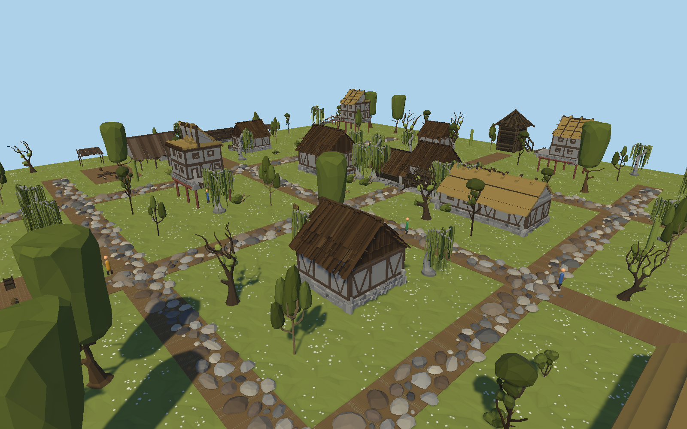
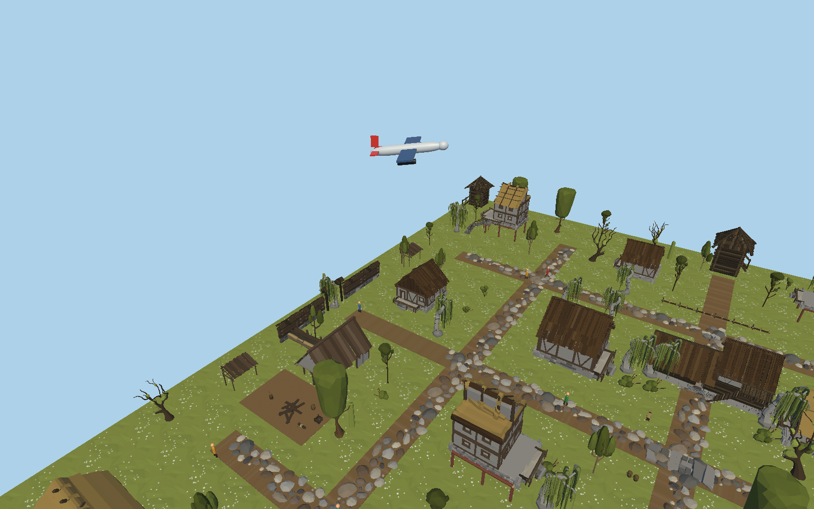

# ЭФБО-10-23 Ефремов Алексей Игоревич

# Практическая 6–7

## Задание

1. В сцену виртуального города практического занятия 4–5 вставьте динамические объекты (автомобили, люди и др.). Задайте движение этих объектов с помощью программного кода. Движения должны быть реалистичны.

2. В сцену виртуального города добавьте большой объект. Это может быть поезд или самолет. Задайте его движение. Например, поезд приходит, останавливается и уходит. Например, самолет может пролетать над городом имитируя взлет с аэродрома или заход на посадку. Объект должен двигаться реалистично.

## Скриншоты выполненной сцены

### Движущиеся пешеходы в виртуальном городе

### Полёт самолёта над виртуальным городом

