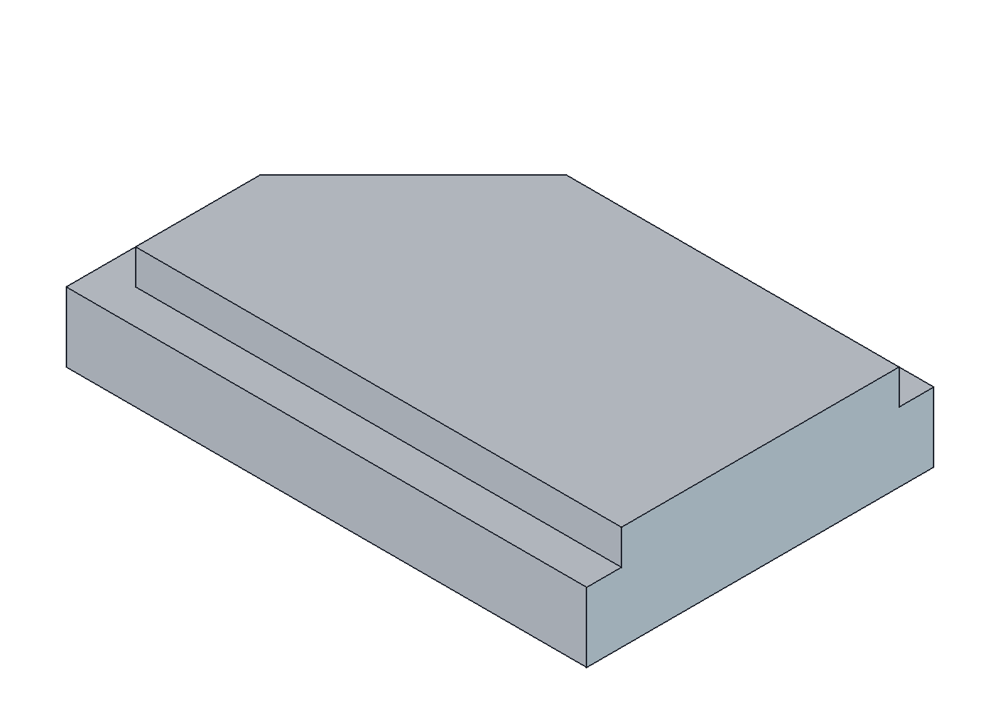
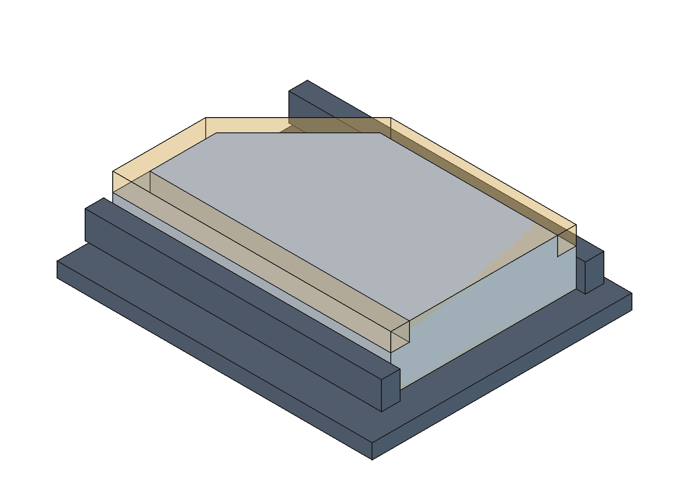
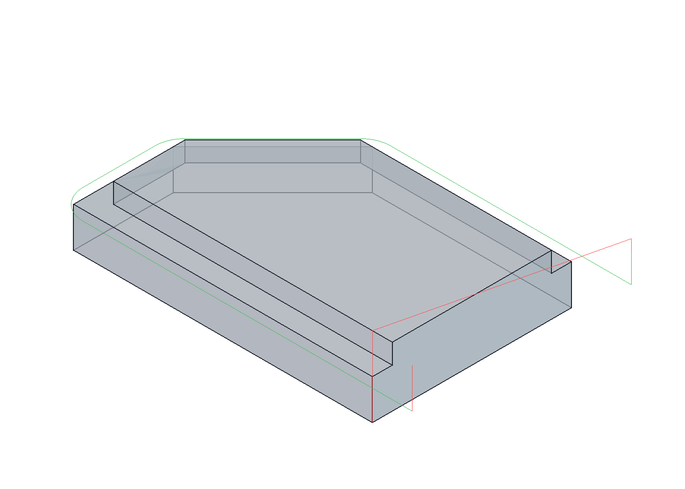

# Практическое занятие № 11

## Разработка управляющей программы для 3-х координатного фрезерного станка: торцевое и контурное фрезерование

**Вариант:** 9  
**Среда выполнения:** FreeCAD 1.1.4, рабочая среда CAM.

Методичка задаёт одну общую работу для занятий 11-12. Для обоих отчётов используется общий [проект FreeCAD](model11-12.FCStd).

### Модель детали

Модель построена по рис. 44. Габариты исходного контура — 150 × 100 мм; нижняя часть имеет высоту 20 мм, общая высота детали — 30 мм. Верхний контур задан размерами 140; 95,86; 45,86 мм и отступами 10 мм.



### Настройка обработки

Заготовка: контур со скосом по эскизу, высота 30 мм. Верхняя плоскость считается предварительно обработанной; торцевание в текущий Job не входит. Выполняется только боковая контурная обработка по выбранному упрощённому варианту. Ноль W — правый нижний угол основания: X = 0, Y = 0, Z = 0; материал расположен преимущественно при X ≤ 0, Y ≥ 0. Точка смены НИ: (50; 50; 150) мм.

| Переход | Инструмент | Подача, мм/мин | Обороты, об/мин | Глубина обработки |
|---|---|---:|---:|---|
| Внешний контур верхней ступени | T2, концевая фреза Ø30 | 800 | 4000 | Z = 20 мм, один проход по глубине |

Диаметр T2 Ø30 указан на эскизе. Используется один инструмент T2. Контур обрабатывается один раз на Z = 20 мм: заход справа, верхняя сторона, скос, левая сторона, нижняя сторона и выход справа, по образцу практики №4. Правая сторона не обходится. Центр фрезы смещён наружу на 15 мм; переходы между сторонами заданы тремя точными дугами G3. Маршрут хранится в операции CAM Custom «OpenContour» и формируется скриптом по геометрии эскиза и диаметру инструмента. При изменении диаметра или размеров необходимо повторить построение. Подача врезания — 250 мм/мин. Снятие всей высоты 10 мм за один проход принято для учебной симуляции; режим не проверен на реальном станке.

Закрепление показано условной моделью тисков. Размеры приспособления выбраны для учебной визуализации.



### Траектории и симуляция



Снятие материала рассчитано булевым вычитанием объёма, занимаемого фрезой на каждом перемещении, из исходного твердого тела заготовки со скосом. Результат сравнён с моделью детали: лишний и зарезанный объёмы не обнаружены при допуске булевых операций 0,001 мм. Верхняя плоскость заготовки изначально находится на Z = 30 мм; обработан только боковой контур верхней ступени до Z = 20 мм. Симуляция относится к заготовке; кинематика станка и столкновения с приспособлением не моделировались.


### Управляющая программа

Выбран учебный формат Fanuc: миллиметры G21, абсолютные координаты G90, минутная подача G94, система координат G54. Радиус фрезы учтён в CAM; в УП применяется G40. Инструменты считаются предварительно настроенными по кончику, без таблицы коррекций длины G43/H. Код проверен структурно; работа на конкретной стойке и полное соответствие ГОСТ 20999 отдельно не проверялись.

Полный файл: [program11-12.nc](program11-12.nc).

```gcode
%
N110 (BEGIN PREAMBLE)
N120 G21
N130 G17 G54 G40 G49 G80 G90 G94
N140 G0 Z150.000
N150 G0 X50.000 Y50.000
N160 G21
N170 (BEGIN OPERATION: T2 ENDMILL D30)
N180 (MACHINE UNITS: MM/MIN)
N190  (T2 ENDMILL D30)
N200 M05
N210  M6 T2
N220  M3 S4000
N230 (FINISH OPERATION: T2 ENDMILL D30)
N240 (BEGIN OPERATION: OPEN CONTOUR - ONE PASS Z20)
N250 (MACHINE UNITS: MM/MIN)
N260 (COOLANT ON:FLOOD)
N270 M8
N280  (OPEN CONTOUR - ONE PASS Z20)
N290  (BEGIN CUSTOM)
N300  G0 Z40.000
N310  X25.000 Y105.000
N320  Z35.000
N330  G1 Z20.000 F250.000
N340  X-95.860 F800.000
N350  G3 X-106.467 Y100.607 I0.000 J-15.000
N360  G1 X-150.607 Y56.467
N370  G3 X-155.000 Y45.860 I10.607 J-10.607
N380  G1 Y10.000
N390  G3 X-140.000 Y-5.000 I15.000 J0.000
N400  G1 X25.000
N410  G0 Z40.000
N420  (END CUSTOM)
N430 (FINISH OPERATION: OPEN CONTOUR - ONE PASS Z20)
N440 (COOLANT OFF:FLOOD)
N450 M9
(BEGIN POSTAMBLE)
N460 G0 Z150.000
N470 G0 X50.000 Y50.000
N480 M9
N490 M5
N500 M30
```

Допущения и особенности исходной методички перечислены в [README](README.md).
