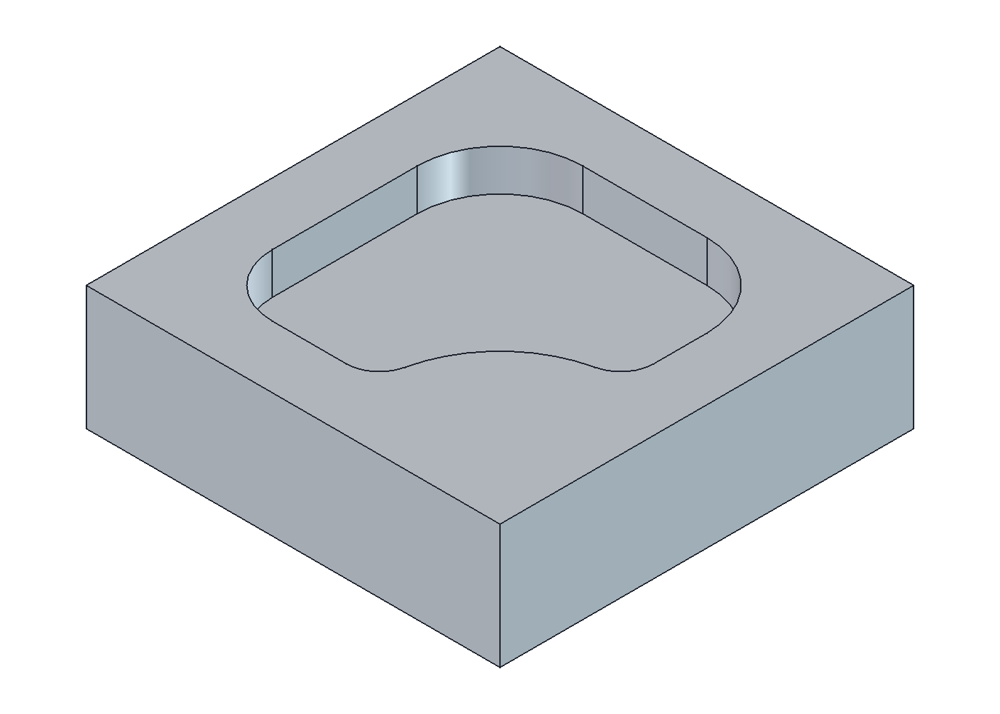
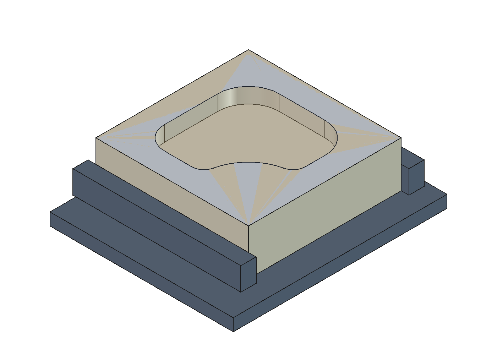
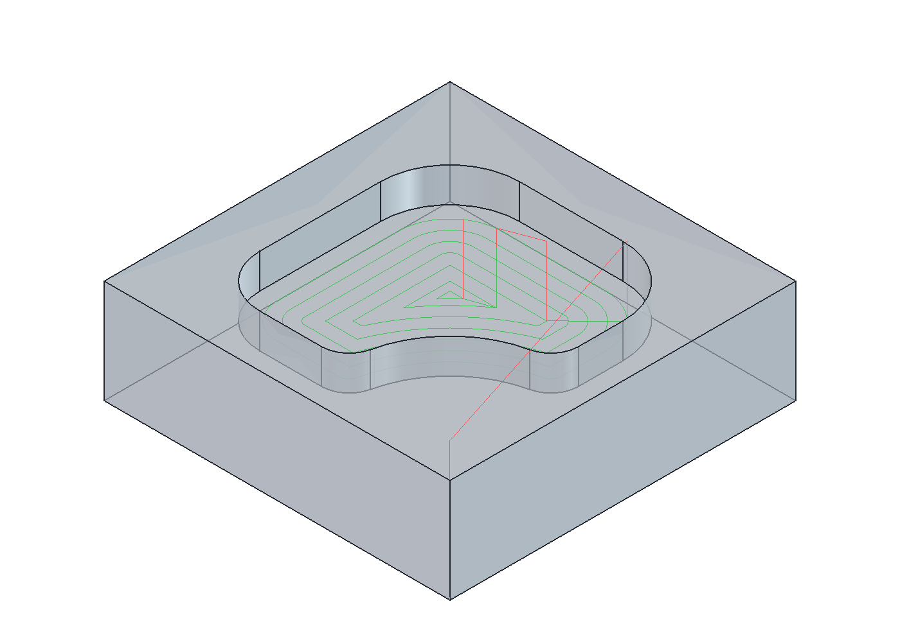

# Практическое занятие № 13

## Разработка управляющей программы для 3-х координатного фрезерного станка: фрезерование закрытого кармана

**Вариант:** 9  
**Среда выполнения:** FreeCAD 1.1.4, рабочая среда CAM.

Методичка задаёт одну общую работу для занятий 13-14. Для обоих отчётов используется общий [проект FreeCAD](model13-14.FCStd).

### Модель детали

Модель построена по рис. 65 (в подписи исходника — «Рисунок 455»). Габариты блока — 100 × 100 × 30 мм. Карман занимает область 70 × 70 мм с отступами по 15 мм; его контур содержит R20, R15, R30 и два сопряжения R8. Дно находится на Z = 20 мм, поэтому глубина кармана от верхней поверхности Z = 30 мм составляет 10 мм.



### Настройка обработки

Заготовка: 100 × 100 × 30 мм. Ноль W — правый нижний угол на нижней плоскости: (0; 0; 0); материал занимает X = −100…0, Y = 0…100, Z = 0…30 мм. Точка смены НИ: (−50; 350; 250) мм.

| Переход | Инструмент | Подача, мм/мин | Обороты, об/мин | Глубина обработки |
|---|---|---:|---:|---|
| Закрытый карман | T5, концевая фреза Ø10 | 1600 | 8000 | Z = 20 мм, один проход по глубине |

Диаметр инструмента Ø10 и обозначение T5 взяты с эскиза. Выбрана полная выборка кармана на одном уровне Z = 20 мм, со смещением соседних проходов 40% диаметра. Включены KeepToolDown и MinTravel для сокращения подъёмов и переходов. Внутренние проходы сохранены: один обход стенки из практики №9 не удаляет материал в середине сплошной заготовки. Подача вертикального врезания — 250 мм/мин. Глубина 10 мм за один проход принята для учебной симуляции и не проверена для реального станка. Точки касания сопряжений вычислены из радиусов. Значения 7,82 / 23,01 / 21,32 мм на эскизе являются округлёнными координатными размерами этих сопряжений.

Закрепление показано условной моделью тисков. Размеры приспособления выбраны для учебной визуализации.



### Траектории и симуляция



Снятие материала рассчитано движком CAM Simulator FreeCAD с сеткой 0,20 мм. Получен закрытый карман с дном Z = 20 мм и сопряжениями по эскизу. Дополнительно выполнена выборочная проверка траектории: 1995 точек пути у стенок и 15709 точек внутри кармана на сетке 0,5 мм. Непокрытых точек не найдено; максимальное выявленное отклонение у стенки — 0,0063 мм при принятом допуске проверки 0,05 мм. Это выборочная проверка, а не доказательство точного совпадения поверхностей. Симуляция относится к заготовке; кинематика станка и столкновения с приспособлением не моделировались.


### Управляющая программа

Выбран учебный формат Fanuc: миллиметры G21, абсолютные координаты G90, минутная подача G94, система координат G54. Радиус фрезы учтён в CAM; в УП применяется G40. Инструменты считаются предварительно настроенными по кончику, без таблицы коррекций длины G43/H. Код проверен структурно; работа на конкретной стойке и полное соответствие ГОСТ 20999 отдельно не проверялись.

Полная программа содержит 90 строк и сохранена в [program13-14.nc](program13-14.nc).

```gcode
%
N110 (BEGIN PREAMBLE)
N120 G21
N130 G17 G54 G40 G49 G80 G90 G94
N140 G0 Z250.000
N150 G0 X-50.000 Y350.000
N160 G21
N170 (BEGIN OPERATION: T5 ENDMILL D10)
N180 (MACHINE UNITS: MM/MIN)
N190  (T5 ENDMILL D10)
N200 M05
N210  M6 T5
N220  M3 S8000
N230 (FINISH OPERATION: T5 ENDMILL D10)
N240 (BEGIN OPERATION: POCKET)
N250 (MACHINE UNITS: MM/MIN)
N260 (COOLANT ON:FLOOD)
N270 M8
N280  (POCKET)
N290  G0 Z40.000
N300  X-24.395 Y75.604
N310  Z35.000
N320  G1 Z20.000 F250.000
N330  G3 X-35.079 Y80.000 I-10.612 J-10.611 F1600.000
N340  G1 X-64.921
N350  G3 X-80.000 Y64.921 I-0.072 J-15.006
N360  G1 Y30.089
N370  G3 X-69.911 Y20.000 I10.008 J-0.081
N380  G1 X-52.270
N390  G3 X-49.174 Y22.547 I0.096 J3.038
N400  G2 X-22.547 Y49.174 I34.169 J-7.542
N410  G3 X-20.000 Y52.270 I-0.491 J3.000
N420  G1 Y64.921
N430  G3 X-24.395 Y75.604 I-15.006 J0.072
N440  G1 X-27.225 Y72.775 F250.000
N450  G3 X-35.141 Y76.000 I-7.788 J-7.787 F1600.000
N460  G1 X-64.859
N470  G3 X-76.000 Y64.859 I-0.129 J-11.013
N480  G1 Y30.161
N490  G3 X-69.839 Y24.000 I6.018 J-0.143
N500  G1 X-52.938
N510  G2 X-24.000 Y52.938 I37.906 J-8.967
N520  G1 Y64.859
N530  G3 X-27.225 Y72.775 I-11.013 J0.129
N540  G1 X-30.055 Y69.945 F250.000
N550  G3 X-35.204 Y72.000 I-4.967 J-4.966 F1600.000
N560  G1 X-64.796 Y72.000
N570  G3 X-72.000 Y64.796 I-0.183 J-7.021
N580  G1 Y30.232
N590  G3 X-69.768 Y28.000 I2.041 J-0.191
N600  G1 X-55.984
N610  G2 X-28.000 Y55.984 I40.979 J-12.995
N620  G1 X-28.000 Y64.796
N630  G3 X-30.055 Y69.945 I-7.021 J0.183
N640  G1 X-32.885 Y67.115 F250.000
N650  G3 X-35.267 Y68.000 I-2.156 J-2.156 F1600.000
N660  G1 X-64.733
N670  G3 X-68.000 Y64.733 I-0.226 J-3.041
N680  G1 Y32.000
N690  X-58.814
N700  G2 X-32.000 Y58.814 I43.812 J-16.998
N710  G1 X-32.000 Y64.733
N720  G3 X-32.885 Y67.115 I-3.041 J0.226
N730  G1 X-36.000 Y64.000 F250.000
N740  X-64.000 F1600.000
N750  Y36.000
N760  X-61.470
N770  G2 X-36.000 Y61.470 I46.450 J-20.980
N780  G1 Y64.000
N790  G0 Z40.000
N800  X-46.609 Y60.000
N810  Z35.000
N820  G1 Z20.000 F250.000
N830  X-60.000 F1600.000
N840  Y46.609
N850  G2 X-46.609 Y60.000 I44.835 J-31.445
N860  G1 X-53.716 Y57.500 F250.000
N870  X-57.500 F1600.000
N880  Y53.716
N890  G2 X-53.716 Y57.500 I39.516 J-35.732
N900  G0 Z40.000
N910 (FINISH OPERATION: POCKET)
N920 (COOLANT OFF:FLOOD)
N930 M9
(BEGIN POSTAMBLE)
N940 G0 Z250.000
N950 G0 X-50.000 Y350.000
N960 M9
N970 M5
N980 M30
```

Допущения и особенности исходной методички перечислены в [README](README.md).
