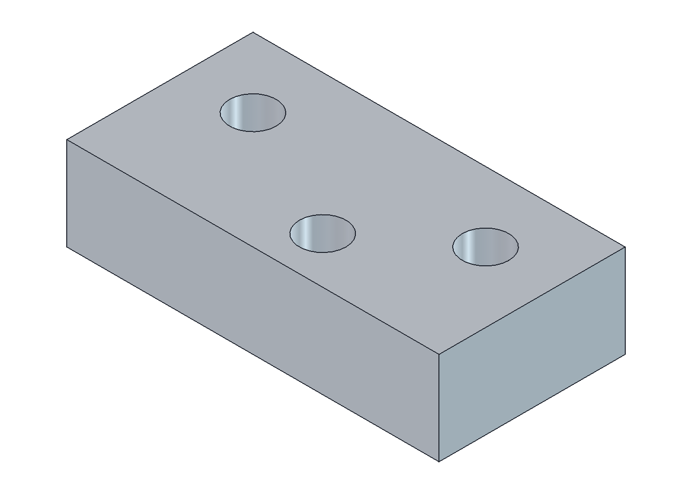
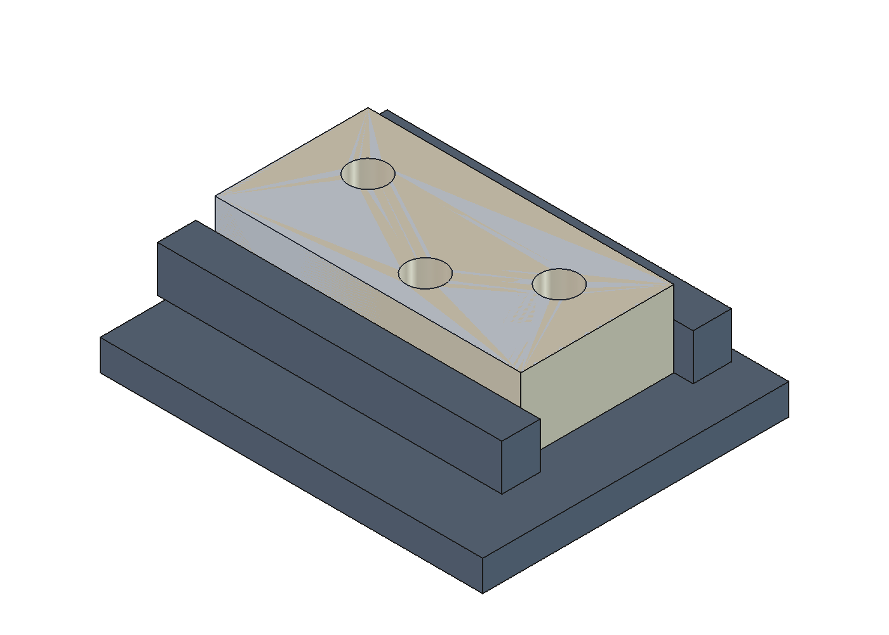
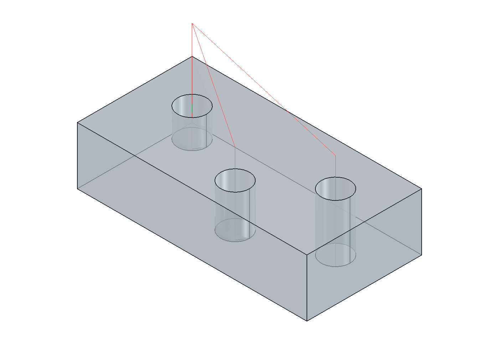
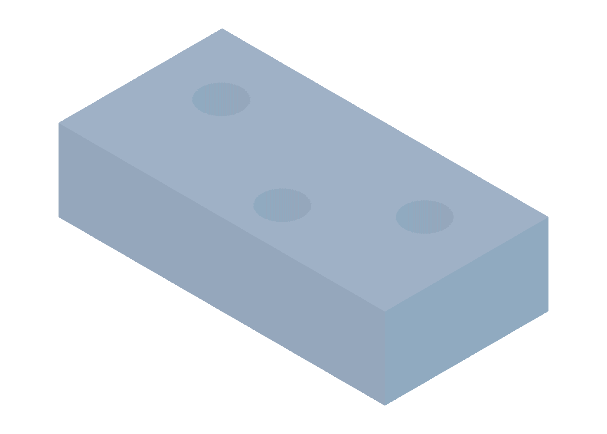
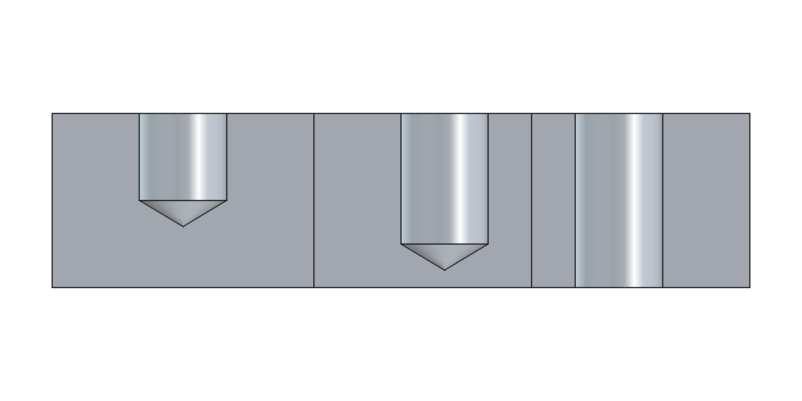

# Практическое занятие № 15

## Разработка управляющей программы для 3-х координатного фрезерного станка: сверление

**Вариант:** 9  
**Среда выполнения:** FreeCAD 1.1.4, рабочая среда CAM.

Методичка задаёт одну общую работу для занятий 15-16. Для обоих отчётов используется общий [проект FreeCAD](model15-16.FCStd).

### Модель детали

Модель построена по рис. 81 (в подписи исходника — «Рисунок 8146»). Габариты блока — 80 × 40 × 20 мм. Выполняются три отверстия номинального диаметра Ø10: два глухих и одно сквозное.



### Настройка обработки

Заготовка: 80 × 40 × 20 мм. Ноль W — левый верхний угол верхней плоскости: (0; 0; 0); материал занимает X = 0…80, Y = −40…0, Z = −20…0 мм. Точка смены НИ: (40; 100; 250) мм.

| Отверстие | X, мм | Y, мм | Конечное Z вершины сверла, мм |
|---|---:|---:|---:|
| 1, глухое | 15 | −15 | −13 |
| 2, глухое | 45 | −30 | −18 |
| 3, сквозное | 65 | −15 | −23,504 |

Инструмент T5 — сверло Ø10; подача 250 мм/мин, частота вращения 2500 об/мин. Используются три цикла G81 с возвратом G98 и плоскостью R = 3 мм. Для модели принят угол вершины сверла 118°. Глубины глухих отверстий 13 и 18 мм трактуются до вершины сверла. Для сквозного отверстия учтены высота вершины 3,004 мм и дополнительный выход 0,5 мм за нижнюю плоскость. Координаты выбраны по размерам, а не по масштабу рисунка: первое и третье отверстия имеют Y = −15 мм.

Закрепление показано условной моделью тисков. Размеры приспособления выбраны для учебной визуализации.



### Траектории и симуляция



Снятие материала рассчитано движком CAM Simulator FreeCAD с сеткой 0,20 мм. Получены два глухих отверстия разных глубин и одно сквозное отверстие. Симуляция относится к заготовке; кинематика станка и столкновения с приспособлением не моделировались.



Ступенчатый разрез A–A показывает форму и глубины отверстий:



### Управляющая программа

Выбран учебный формат Fanuc: миллиметры G21, абсолютные координаты G90, минутная подача G94, система координат G54. Радиус фрезы учтён в CAM; в УП применяется G40. Инструменты считаются предварительно настроенными по кончику, без таблицы коррекций длины G43/H. Код проверен структурно; работа на конкретной стойке и полное соответствие ГОСТ 20999 отдельно не проверялись.

Полный файл: [program15-16.nc](program15-16.nc).

```gcode
%
N110 (BEGIN PREAMBLE)
N120 G21
N130 G17 G54 G40 G49 G80 G90 G94
N140 G0 Z250.000
N150 G0 X40.000 Y100.000
N160 G21
N170 (BEGIN OPERATION: T5 DRILL D10)
N180 (MACHINE UNITS: MM/MIN)
N190  (T5 DRILL D10)
N200 M05
N210  M6 T5
N220  M3 S2500
N230 (FINISH OPERATION: T5 DRILL D10)
N240 (BEGIN OPERATION: DRILLHOLE1)
N250 (MACHINE UNITS: MM/MIN)
N260 (COOLANT ON:FLOOD)
N270 M8
N280  (DRILLHOLE1)
N290  (BEGIN DRILLING)
N300  G90
N310  G0 Z10.000
N320  G98
N330  G0 X15.000 Y-15.000
N340  Z5.000
N350  G81 Z-13.000 F250.000 R3.000
N360  G80
N370  G0 Z10.000
N380 (FINISH OPERATION: DRILLHOLE1)
N390 (COOLANT OFF:FLOOD)
N400 M9
N410 (BEGIN OPERATION: DRILLHOLE2)
N420 (MACHINE UNITS: MM/MIN)
N430 (COOLANT ON:FLOOD)
N440 M8
N450  (DRILLHOLE2)
N460  (BEGIN DRILLING)
N470  G90
N480  G0 Z10.000
N490  G98
N500  G0 X45.000 Y-30.000
N510  Z5.000
N520  G81 Z-18.000 F250.000 R3.000
N530  G80
N540  G0 Z10.000
N550 (FINISH OPERATION: DRILLHOLE2)
N560 (COOLANT OFF:FLOOD)
N570 M9
N580 (BEGIN OPERATION: DRILLHOLE3)
N590 (MACHINE UNITS: MM/MIN)
N600 (COOLANT ON:FLOOD)
N610 M8
N620  (DRILLHOLE3)
N630  (BEGIN DRILLING)
N640  G90
N650  G0 Z10.000
N660  G98
N670  G0 X65.000 Y-15.000
N680  Z5.000
N690  G81 Z-23.504 F250.000 R3.000
N700  G80
N710  G0 Z10.000
N720 (FINISH OPERATION: DRILLHOLE3)
N730 (COOLANT OFF:FLOOD)
N740 M9
(BEGIN POSTAMBLE)
N750 G0 Z250.000
N760 G0 X40.000 Y100.000
N770 M9
N780 M5
N790 M30
```

Допущения и особенности исходной методички перечислены в [README](README.md).
