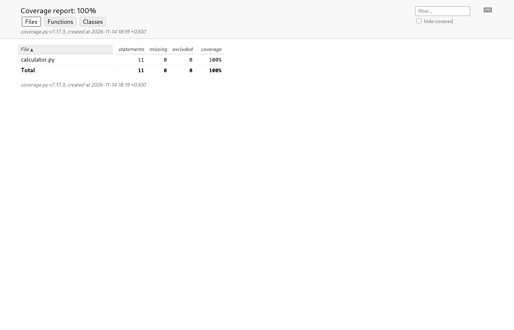
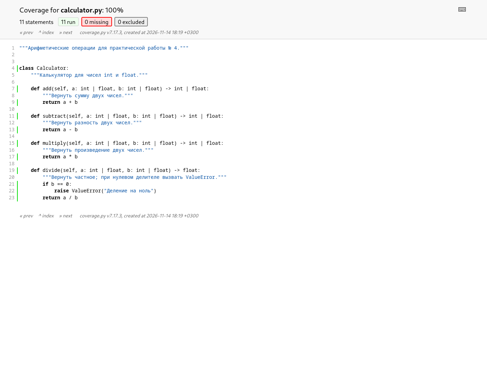

# Практическая работа № 4
## Юнит-тестирование на Python. Основы pytest

**Дисциплина:** Технологии тестирования программных продуктов  
**ФИО:** Ефремов Алексей, Никитин Артемий  
**Группа:** ЭФБО-10-23  
**Дата проверки:** 14.11.2026

## Описание выполненной работы

В [calculator.py](calculator.py) реализован класс Calculator с методами `add`, `subtract`, `multiply`, `divide` для `int` и `float`. При делении на ноль вызывается `ValueError` с сообщением «Деление на ноль».

В [test_calculator.py](test_calculator.py) подготовлены 8 независимых параметризованных функций — 36 тестовых случаев. Каждый случай создаёт собственный Calculator и следует структуре AAA.

| Проверки | Число случаев |
| --- | ---: |
| Сложение целых и дробных чисел | 8 |
| Вычитание целых и дробных чисел | 7 |
| Умножение целых и дробных чисел | 8 |
| Деление целых и дробных чисел | 9 |
| Деление на ноль через `pytest.raises` | 4 |

Проверены положительные, отрицательные, нулевые и большие значения. Для сложения целых чисел задано 6 наборов параметров, для вычитания — 5. Дробные результаты сравниваются через `pytest.approx`, включая деление `7.5 / 2.5` и `1 / 3`.

## Запуск и результаты

Окружение: CachyOS Linux, Python 3.14.8, pytest 9.2.0, pytest-cov 7.1.0. Команда из каталога `pr4`:

```bash
.venv/bin/python -m pytest test_calculator.py -v --cov=calculator --cov-report=term-missing --cov-report=html:htmlcov --cov-report=json:coverage.json --cov-fail-under=90
```

Результат выполненного запуска:

```text
Name            Stmts   Miss  Cover   Missing
---------------------------------------------
calculator.py      11      0   100%
---------------------------------------------
TOTAL              11      0   100%
Required test coverage of 90% reached. Total coverage: 100.00%
36 passed in 0.11s
```

Все 36 случаев пройдены. Покрытие строк — 100% при требуемых 90%. Сохранены [HTML-отчёт](htmlcov/index.html) и [JSON-отчёт](coverage.json).





## Ответы на контрольные вопросы

### 1. Чем юнит-тест отличается от smoke-проверки?

Юнит-тест проверяет отдельную функцию или класс в изоляции. Smoke-проверка оценивает базовую работоспособность основных функций приложения и возможность продолжать тестирование.

### 2. Что означает структура AAA?

Arrange — подготовить данные и объект; Act — выполнить проверяемое действие; Assert — проверить результат или исключение.

### 3. Зачем нужна параметризация тестов?

Она запускает одну тестовую функцию на разных наборах данных без дублирования кода. Каждый набор имеет отдельный результат проверки.

### 4. Что показывает coverage и почему 100% не всегда нужно?

Coverage показывает долю строк или ветвей, выполненных тестами. Выполнение всех строк не гарантирует проверку всех входных данных и правильности результатов. В больших проектах достижение последних процентов может требовать неоправданных затрат; важнее проверить критичные сценарии содержательными утверждениями.

### 5. Почему тесты должны быть независимыми друг от друга?

Чтобы результат не зависел от порядка запуска и состояния, оставленного другими тестами. Независимые тесты можно запускать отдельно и параллельно, а причины ошибок проще найти.
